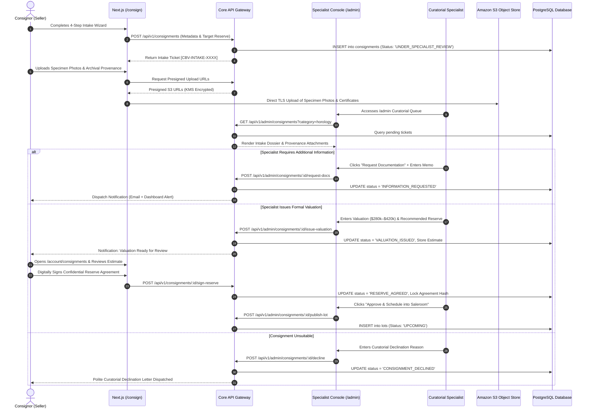
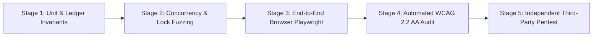

# ChronoBid Vault — Phase 3 Technical Architecture Specification (Draft)
## Production System Topology, Concurrency Architecture, Financial Ledger & Curatorial Systems

> **Document Type:** Production Engineering Blueprint, Financial Ledger Design & Security Architecture  
> **Project Name:** ChronoBid Vault — Curated Fine Horology & Global Multi-Category Auction Marketplace  
> **Baseline Evaluated:** Phase 2.1 Clickable Frontend Prototype (Next.js 14 App Router, 4-Division Taxonomy)  
> **Draft Date:** 23 October 2026  
> **Authoring Team:** Principal Solutions Architect, Senior Financial Systems Analyst, Senior QA Engineering Lead, Chief Information Security Officer (CISO)  
> **Current Governance Status:** **PLANNING & SPECIFICATION ONLY — IMPLEMENTATION REMAINS STRICTLY NOT AUTHORIZED**  
> **Prohibitions in Effect:** Phase 3 implementation (code, databases, migrations, cloud infrastructure) and Phase 4 (real money, payment rails, custody) remain strictly **NO-GO — NOT AUTHORIZED**  

---

## Executive Summary & Scope

This specification establishes the production-oriented technical architecture, concurrency models, financial ledger invariants, security controls, and infrastructure designs required to transition ChronoBid Vault from the verified **Phase 2.1 clickable frontend prototype** into an enterprise-grade, high-concurrency, legally compliant international auction platform (**Phase 3 and beyond**).

The approved Phase 2.1 prototype successfully validated the four-division visual identity (Fine Horology, Rare Coins & Numismatics, Haute Joaillerie, Fine Art), polymorphic catalog browsing, curatorial specialist workflows (`/admin`), and the mathematical rules of the **Pre-Funded Vault** and **Soft-Close Anti-Sniping** systems using client-side reactive simulation. 

Phase 3 establishes the engineering blueprint to replace client-side simulations with:
1. **Server-authoritative distributed auction engines** with sub-millisecond atomic bid serialization and NTP-synchronized clocks.
2. **Bank-grade double-entry financial ledgers** with atomic cross-lot reservation enforcement and continuous statement reconciliation.
3. **Hardened cryptographic identity (OAuth 2.0 / OIDC / FIDO2 WebAuthn)** and role-based access control (RBAC).
4. **End-to-end curatorial intake and consignment management** bridging consignor requests with specialist appraisals.
5. **Multi-AZ fault-tolerant cloud infrastructure** with automated disaster recovery, zero single points of failure, and strict regulatory isolation.

> [!IMPORTANT]
> **GOVERNANCE STATUS DECLARATION:**  
> This document is an architectural planning draft prepared strictly for Project Owner review. **Zero production code, database schemas, Docker containers, cloud resources, or payment integrations are authorized by this document.** Phase 2.1 prototype was formally accepted by the Project Owner on 25 October 2026. Phase 3 architecture remains subject to separate owner review and approval. Phase 3 backend and Phase 4 production implementation remain strictly **NO-GO — NOT AUTHORIZED**.

---

## 1. System Architecture & Topology

ChronoBid Vault requires sub-millisecond concurrency control, zero financial rounding discrepancies, and 99.99% availability during live saleroom execution. The architecture adopts a **Modular Monolith core** paired with an **Event-Driven Bidding Gateway** (per Architectural Decision Record `ADR-P3-001`), balancing rapid engineering velocity with real-time performance.

```
+----------------------------------------------------------------------------------------------------+
|                             CHRONOBID VAULT PRODUCTION TOPOLOGY                                    |
+----------------------------------------------------------------------------------------------------+
                                                  │
                                                  ▼
                                      [Cloudflare Edge Network]
                           (WAF, DDoS Shield, Anycast CDN, Turnstile Bot Detection)
                                                  │
                        ┌─────────────────────────┴─────────────────────────┐
                        │ (HTTPS REST / GraphQL)                            │ (WSS Real-Time Sockets)
                        ▼                                                   ▼
            [Next.js 14 App Router]                             [Live Saleroom Gateway]
           (SSR / Frontend Presentation)                         (Fastify WebSocket Monolith)
                        │                                                   │
                        └─────────────────────────┬─────────────────────────┘
                                                  │ (Internal Service Calls)
                                                  ▼
                                     [Core API Service Layer]
                        (Node.js / Fastify Modular Monolith running on AWS ECS)
                                                  │
                     ┌────────────────────────────┼────────────────────────────┐
                     ▼                            ▼                            ▼
            [Auth & RBAC Module]       [Consignment & Admin Module]   [Auction Engine Core]
                     │                            │                            │
                     └────────────────────────────┼────────────────────────────┘
                                                  │
                                                  ▼
                                    [Internal Event / State Bus]
                                 (Amazon ElastiCache Redis Cluster)
                                  - Saleroom Channel Pub/Sub
                                  - Distributed Locks (Redlock)
                                  - Rate-Limiting Sliding Buckets
                                                  │
                        ┌─────────────────────────┴─────────────────────────┐
                        ▼                                                   ▼
             [Vault Ledger Engine]                                [Worker Subsystems]
             - Double-Entry Posting                               - Transac Email (Resend)
             - Atomic Headroom Lock                               - Webhooks & Bank Inflow
             - Daily Bank Reconciliation                          - S3 Async Asset Processing
                        │                                                   │
                        └─────────────────────────┬─────────────────────────┘
                                                  │
                                                  ▼
                                    [Amazon Aurora PostgreSQL Multi-AZ]
                                  - Strict ACID Relational Transactions
                                  - Row-Level Locking (SELECT ... FOR UPDATE)
                                  - Polymorphic JSONB Specification Store
                                  - Read Replicas for Heavy Catalog Queries
```

---

### 1.1 Structural Component Responsibilities & Boundaries

| Subsystem Component | Recommended Production Stack | Core Operational Responsibility | Isolation Boundary |
| :--- | :--- | :--- | :--- |
| **Frontend Presentation** | Next.js 14 App Router (React, TypeScript, Tailwind CSS) | Delivers the editorial-parallax interface, renders Server Components for rapid initial paint, manages client hydration boundaries, and establishes live saleroom WebSocket connections. | Public CDN / Browser runtime. Strictly decoupled from database credentials. |
| **Edge Security & Routing** | Cloudflare Pro / Business Tier ($20–$200/mo) | Terminates global Anycast SSL, filters DDoS attacks, executes Web Application Firewall (WAF) rule sets, manages rate limiting, and issues Cloudflare Turnstile anti-bot challenges. Cloudflare Enterprise ($3,000+/mo, $36k/yr commitment) is deferred for scale per ADR-P3-001 Section 5.2. | Edge network perimeter. Zero unauthorized traffic reaches application origin. |
| **Core API Modular Monolith** | Node.js 22 LTS (Fastify framework, TypeScript) | Hosts modular business domains: Authentication, User Accounts, Consignment Intake, Polymorphic Catalog Dossiers, and Curatorial Admin APIs. Shared TypeScript models with frontend. | Private VPC subnet. Accessible only via Application Load Balancer (ALB). |
| **Live Saleroom Gateway** | Fastify WebSocket Server (Node.js 22 / `ws`) | Maintains long-lived, bi-directional WebSocket connections with saleroom collectors. Broadcasts real-time bid updates, countdown ticks, and soft-close extensions with sub-50ms latency. | Private VPC subnet. Redis Pub/Sub cluster enables horizontal node scaling. |
| **Auction Engine Core** | In-Memory Saleroom Coordinator + PostgreSQL Transaction Engine | Enforces the 5-tier Option B increment ladder, triggers the 120-second soft-close timer, monitors the 10-extension hard cap, and coordinates atomic bid acceptance. | Atomic transaction boundary inside PostgreSQL with distributed Redis synchronization. |
| **Vault Ledger Engine** | Immutable Double-Entry Ledger Subsystem | Manages buyer balances (`Available`, `Reserved`, `Committed`, `Settled`, `Holds`). Executes serialized debit/credit postings with zero floating-point arithmetic. Reconciles bank statements. | High-security internal service module. Direct DB access restricted to ledger tables. |
| **Primary Relational Store** | Amazon Aurora PostgreSQL (Multi-AZ Cluster) | Single source of truth for auction state, bids, users, consignments, and ledger transactions. Leverages `SELECT ... FOR UPDATE` row locks and JSONB polymorphic attributes. | Isolated private DB subnet. Zero public IP routing. Encrypted at rest via AWS KMS. |
| **In-Memory Cache & Bus** | Amazon ElastiCache for Redis (Cluster Mode) | Distributed pub/sub bus for saleroom events, Redlock distributed locking primitives, session token blacklists, and microsecond-level rate-limiting counters. | Private VPC subnet. In-transit encryption enabled. |
| **Object & Document Storage** | Amazon S3 with CloudFront CDN & AWS KMS | Houses high-resolution specimen photography, Timegrapher plots, gemmological certificates (SSEF/Gübelin/GIA), museum provenance deeds, and encrypted KYC passports. | S3 bucket policies enforcing TLS 1.3 and KMS server-side encryption (`aws:kms`). |
| **Observability & Audit** | OpenTelemetry, Prometheus, Grafana, AWS CloudWatch, Sentry | Comprehensive APM monitoring: WebSocket connection density, event-loop lag, database transaction duration, p99 API latencies, and tamper-evident audit log shipping. | Dedicated security/observability VPC peering. Immutable log retention for 7 years. |

---

## 2. Auction Integrity & Saleroom Mechanics

The integrity of the live saleroom is the platform's core operational asset. The system must guarantee mathematical fairness, prevent race conditions under high-concurrency bidding wars, and enforce all rules deterministically.

```
========================================================================================
LIVE SALEROOM BID INGESTION & CONCURRENCY PIPELINE
========================================================================================

[Client Inbound Bid: $25,000 on Lot 01] 
         │ (Includes Idempotency-Key: "uuid-xxxx" & Bearer JWT)
         ▼
[Live Saleroom Gateway (Fastify WS)]
         │ 1. Validate JWT session authenticity & active virtual paddle
         │ 2. Check Redis sliding rate-limiter (< 10 requests / sec)
         │ 3. Check Redis Idempotency-Key (Drop if duplicate in-flight)
         ▼
[PostgreSQL ACID Transaction Initiated (READ COMMITTED)]
         │
         │── Step A: Global Lock Acquisition Hierarchy
          │   1. SELECT ... FROM lots WHERE id = 'Lot01' FOR UPDATE;
          │      (Acquires exclusive lock on Lot row - serializes all bids on this lot)
          │   2. Determine Vault Accounts Requiring Mutation:
          │      - If outbid event (previous leader exists and != $userId):
          │        SELECT ... FROM vault_accounts WHERE user_id IN ($userId, $prevLeaderId) ORDER BY user_id ASC FOR UPDATE;
          │        (Crucial Rule 3: Deterministic ascending primary-key order eliminates cross-account deadlocks)
          │      - Else (opening bid or self-increment):
          │        SELECT ... FROM vault_accounts WHERE user_id = $userId FOR UPDATE;
          │      (Acquires exclusive locks on User Vaults - serializes user headroom)
          │
          │── Step B: Auction Status & Server Clock Validation
          │   - Check lot.status == 'LIVE'
          │   - Check server_now < lot.closing_time (NTP-synchronized server clock)
          │   - If server_now >= lot.closing_time: ROLLBACK & REJECT [AUCTION_CLOSED]
          │
          │── Step C: Option B Increment Ladder Validation
          │   - Current High Bid = $22,000 (Tier 2: $10,000 to $50,000 -> Step = $1,000)
          │   - Minimum Required Bid = $23,000
          │   - Submitted Bid = $25,000 -> Valid step multiple ($22k + 3 * $1k)
          │   - If invalid step: ROLLBACK & REJECT [INVALID_BID_INCREMENT]
          │
          │── Step D: Vault Headroom & Double-Spending Verification
          │   - User Headroom = total_balance - reserved_balance - committed_balance - holds_balance
          │   - Required Headroom Delta = $25,000 (or $3,000 if user held prior $22k lead)
          │   - If Headroom < Delta: ROLLBACK & REJECT [INSUFFICIENT_VAULT_FUNDS]
          │
          │── Step E: Atomic State Mutation & Double-Entry Ledger Posting
          │   1. INSERT into bids (lot_id, user_id, amount_cents, sequence_num, SHA-256 hash)
          │   2. UPDATE lots SET current_bid_cents = 2500000, winner_user_id = $userId
          │   3. User Available to User Reserved: DEBIT 1010 / CREDIT 1020 by $25,000
          │   4. If previous leader was distinct user:
          │      - Instantly release previous leader's reservation: DEBIT 1020 / CREDIT 1010
          │
          │── Step F: Soft-Close Anti-Sniping Evaluation
          │   - Time remaining = lot.closing_time - server_now
          │   - If time_remaining < 120.000 seconds AND lot.extensions_count < 10:
          │       lot.closing_time = server_now + 120.000 seconds
          │       lot.extensions_count += 1
          │   - Else if time_remaining == 120.000 seconds OR extensions_count >= 10:
          │       lot.closing_time unchanged (At exactly 120s or hard cap, bid accepted without clock reset)
         │
         ▼
[COMMIT TRANSACTION]
         │
         ▼
[Redis Saleroom Event Broadcast]
         ├── WSS Saleroom Channel: Broadcast { event: "NEW_HIGH_BID", amount: 25000, paddle: "#4102" }
         ├── WSS Clock Channel: Broadcast { event: "TIMER_RESET", closing_time: "..." }
         └── Private WSS Channel: Notify outbid collector { event: "OUTBID_FUNDS_RESTORED" }
```

---

### 2.1 Concurrency & Atomic Bid Acceptance Invariants
1. **Pessimistic Row-Level Locking:** To prevent concurrent bids from overwriting each other, the database transaction executes `SELECT ... FOR UPDATE` on the target `lots` row immediately upon entry. This enforces strict serialization: only one transaction can evaluate a lot at any given microsecond.
2. **Unified Lock Acquisition Hierarchy:** To completely eliminate database deadlocks during multi-lot concurrent bidding (e.g., Benchmark 2), all transactions acquire locks in strict, alphabetical table hierarchy:
   $\text{Lock Order:} \quad \text{Table } \mathbf{lots} \longrightarrow \text{Table } \mathbf{vault\_accounts} \longrightarrow \text{Table } \mathbf{bids}$
3. **Multi-Account Lock Ordering for Outbid Events (Rule 3):** When processing a bid that outbids a previous leader, the transaction must acquire row-level locks on two distinct `vault_accounts` rows (to reserve funds for the new bidder and release funds for the outbid leader). To prevent classic A-B / B-A deadlock conditions (PostgreSQL error `40P01`), locks on `vault_accounts` MUST ALWAYS be acquired in deterministic ascending order of primary key:
   ```sql
   SELECT * FROM vault_accounts 
   WHERE user_id IN (:newBidder, :prevLeader) 
   ORDER BY user_id ASC FOR UPDATE;
   ```
   This guarantees that concurrent cross-bids between any two users across different lots will always serialize deterministically rather than deadlock.
4. **Idempotency & Duplicate Prevention:** Every bid request submitted over REST or WebSocket must carry an `Idempotency-Key` header containing a client-generated UUIDv4. The gateway stores this key in Redis with a 120-second TTL. If a retry arrives with an identical key, the cached result is returned without re-executing ledger operations.

---

### 2.2 Server-Authoritative Clock & Soft-Close Anti-Sniping
1. **Clock Synchronization:** Application and database servers synchronize their system time via the **AWS Time Sync Service** (NTP, Stratum 1 reference clocks). Drift across cluster nodes is constrained to $<1\text{ ms}$. Client device timestamps are discarded entirely.
2. **Soft-Close Trigger (Strictly Under 120-Second Rule):** If a valid leading bid is accepted when the time remaining on the server clock is **strictly less than 120.000 seconds** ($\text{Time Remaining} < 120.000\text{ s}$), the closing deadline is automatically reset to exactly:
   $\text{New Closing Time} = \text{Server Timestamp of Bid Acceptance} + 120.000\text{ seconds}$
   **Exact 120-Second Boundary Invariant:** Per test assertion `SC-02-EXACT-120S`, if a bid is placed at exactly 120.000 seconds remaining, the bid is accepted as a valid leading bid, but the clock is **not** reset and the extension counter is **not** incremented, conserving extension budget.
3. **Hard Cap (10 Extensions):** Per Project Rule ADR-012, an auction lot may receive a maximum of **10 soft-close extensions** (a maximum addition of 20 minutes). Once the 10th extension has been granted:
   - The UI and WebSocket emit `[FINAL EXTENSION — HARD CLOSE ENFORCED]`.
   - Subsequent leading bids placed within the final 120 seconds are accepted, but **do not reset the clock**.
   - The lot hammer falls inexorably when the countdown reaches `00:00:00`.
4. **Post-Deadline Rejection:** Any bid arriving at or after `00:00:00.000` server time is rejected unconditionally (`[AUCTION_LOT_CLOSED]`), even if client UI network lag makes it appear simultaneous.

---

### 2.3 Configurable Bid Increment Ladder (Option B Baseline)
The production auction engine enforces the approved **Option B 5-Tier Increment Schedule** (configurable per category by specialist administrators):

$$\begin{array}{l|l|l}
\hline
\textbf{Bid Tier (USD Range)} & \textbf{Mandatory Increment Step} & \textbf{Example Acceptable Sequence} \\ \hline
\text{Tier 1: } \$0 - \$9,999 & \$250 & \$5,000 \rightarrow \$5,250 \rightarrow \$5,500 \\
\text{Tier 2: } \$10,000 - \$49,999 & \$1,000 & \$18,000 \rightarrow \$19,000 \rightarrow \$20,000 \\
\text{Tier 3: } \$50,000 - \$99,999 & \$2,500 & \$75,000 \rightarrow \$77,500 \rightarrow \$80,000 \\
\text{Tier 4: } \$100,000 - \$249,999 & \$5,000 & \$140,000 \rightarrow \$145,000 \rightarrow \$150,000 \\
\text{Tier 5: } \$250,000+ & \$10,000 & \$280,000 \rightarrow \$290,000 \rightarrow \$300,000 \\ \hline
\end{array}$$

> [!NOTE]
> **Reconciliation Note (Finding C3):**  
> An earlier draft erroneously listed the Tier 1 increment step as $500 alongside an example in the $18k range. This has been reconciled to ADR-019 and the executable test runner (`tests/qa-verification-runner.js` lines 154–160, test assertions `LAD-01` through `LAD-03`), which verifies the canonical **$250 step** for bids between $1 and $9,999.

- **Misaligned Bid Rejection:** Custom bids that do not align with an exact step multiple above the current ask (e.g., bidding $23,500 when current is $22,000 in Tier 2) are rejected immediately by server validation.
- **Nearest-Step Suggestions:** The WebSocket gateway transmits the 3 next acceptable bid increments alongside every high-bid broadcast.

---

### 2.4 Immutable Bid Ledger & Cryptographic Chaining
- Bids are written to an append-only `bids` table with monotonically increasing sequence IDs (`bid_sequence`).
- Each accepted bid row stores a cryptographic SHA-256 hash chaining it to the preceding bid:
  $$\text{Hash}_n = \text{SHA256}(\text{Hash}_{n-1} \,\|\, \text{LotID} \,\|\, \text{UserID} \,\|\, \text{AmountCents} \,\|\, \text{Timestamp})$$
- This creates a mathematically tamper-evident audit log proving bid sequence order and precluding retroactive tampering by administrators.

---

## 3. Buyer Vault & Financial Ledger Architecture

The Pre-Funded Vault is the financial cornerstone of ChronoBid Vault. In Phase 2, this was simulated client-side via JavaScript variables and `sessionStorage`. **In Phase 3, client-side storage is completely eliminated as a source of truth.** The Pre-Funded Vault is implemented as an **immutable, double-entry financial ledger** operating inside PostgreSQL.

```
+----------------------------------------------------------------------------------------------------+
|                         PRE-FUNDED VAULT DOUBLE-ENTRY BALANCE ARCHITECTURE                         |
+----------------------------------------------------------------------------------------------------+

   [Total Cleared Balance] ────► Sum of all cleared wire/card funds in collector custody account
              │
              ├── [Available to Bid]  ──► Headroom available for new or incremental bids
              │
              ├── [Reserved Funds]    ──► Actively held on current leading bids across open lots
              │
              ├── [Committed Funds]   ──► Won lots awaiting formal invoice settlement
              │
              ├── [Applicable Holds]  ──► Compliance / AML clearance holds or dispute freezes
              │
              └── [Settled Funds]     ──► Finalized payments transferred to platform/consignor
```

---

### 3.1 Mathematical Invariants & Benchmark Verification

The ledger enforces the fundamental Vault formula across all transactions:

$\mathbf{Available\ to\ Bid} = \mathbf{Total\ Vault\ Balance} - \mathbf{Reserved\ Funds} - \mathbf{Committed\ Funds} - \mathbf{Applicable\ Holds}$

Where:
- $\mathbf{Total\ Vault\ Balance}$: Total cleared cash held in segregated bank custody (matching Account 2010 asset).
- $\mathbf{Reserved\ Funds}$: Headroom locked on active leading bids across open lots (Account 1020).
- $\mathbf{Committed\ Funds}$: Funds locked on won lots awaiting formal post-auction invoice settlement (Account 1040, Settlement Escrow Holds).
- $\mathbf{Applicable\ Holds}$: Compliance, KYC, or wire clearance holds (Account 1030) or administrative freezes.

#### Benchmark 1 (Insufficient Funds Rejection):
A collector with an available headroom of ₹1,00,000 ($1,189 USD) submits a commitment of ₹2,00,000 ($2,379 USD).
- Transaction evaluates: $\text{Attempted Bid } (\$2,379) > \text{Available Headroom } (\$1,189)$.
- The bid is rejected prior to acceptance. Zero ledger records are generated. Zero countdown timers extend.

#### Benchmark 2 (Cross-Lot Concurrent Commitment Constraint):
A collector has a total balance of ₹1,00,000 ($1,189 USD). The collector places a leading bid of ₹70,000 ($833 USD) on Lot A (Watch), and simultaneously attempts a ₹60,000 ($714 USD) bid on Lot B (Coin).
- Lock hierarchy serializes Lot A and Lot B transactions.
- Transaction 1 (Lot A) succeeds: $\text{Reserved} = \$833$; $\text{Available} = \$356$ (~₹30,000).
- Transaction 2 (Lot B) evaluates against updated state: Required headroom ($714) > Available headroom ($356).
- Transaction 2 is rejected immediately. Total active commitments cannot exceed ₹1,00,000 under any sequence of concurrent requests.

---

### 3.2 Double-Entry General Ledger Account Structure
All monetary movements are recorded as paired debits and credits adhering to standard chart of accounts:

$$\begin{array}{l|l|l|l}
\hline
\textbf{Account Code} & \textbf{Account Title} & \textbf{Classification} & \textbf{Normal Balance} \\ \hline
\text{1010} & \text{User Available Funds} & \text{Liability (Owed to Collector)} & \text{Credit} \\
\text{1020} & \text{User Reserved Funds (Active Bids)} & \text{Liability (Held on Active Bids)} & \text{Credit} \\
\text{1030} & \text{User Pending Clearance Holds} & \text{Liability (Deposit / Compliance Holds)} & \text{Credit} \\
\text{1040} & \text{Settlement Escrow Holds (Won Hammer + Premium)} & \text{Liability (Committed to Won Lots)} & \text{Credit} \\
\text{2010} & \text{Bank Custody Clearing Account (Escrow Cash)} & \text{Asset (Segregated Client Funds)} & \text{Debit} \\
\text{2050} & \text{Unidentified Clearing Suspense} & \text{Liability (Unallocated Inflow)} & \text{Credit} \\
\text{3010} & \text{Platform Buyer's Premium} & \text{Revenue (Earned Fee Income)} & \text{Credit} \\
\text{3020} & \text{Platform Consignor Commission} & \text{Revenue (Earned Seller Commission)} & \text{Credit} \\
\text{4010} & \text{Consignor Payout Payable (Net Proceeds)} & \text{Liability (Owed to Consignor)} & \text{Credit} \\ \hline
\end{array}$$

> [!NOTE]
> **Statutory Accounting & CPA Review Requirement (Finding C1):**  
> The Chart of Accounts above reconciles the draft with the canonical 9-account structure in `PHASE3_VAULT_LEDGER_DESIGN.md` Section 4. Series 1000 represents platform liabilities owed to collectors; Series 2000 represents bank cash asset clearing (2010) and suspense liabilities (2050); Series 3000 represents platform earned fee revenue; and Series 4000 represents consignor settlement payables.  
> Prior to production implementation, formal review and sign-off by a qualified Certified Public Accountant (CPA) / statutory auditor is required to validate that this account taxonomy complies with US GAAP (ASC 606 / ASC 946) or IFRS fiduciary custody accounting standards and statutory reporting rules.

#### Sample Double-Entry Transaction Ledger Entries:

1. **Collector Wires $150,000 to Vault:**
   - `DEBIT  2010 (Bank Custody Clearing Account)`: $+\$150,000.00$
   - `CREDIT 1010 (User Available Funds)`: $+\$150,000.00$
2. **Collector Places Leading Bid of $22,000 on Lot 01:**
   - `DEBIT  1010 (User Available Funds)`: $-\$22,000.00$
   - `CREDIT 1020 (User Reserved Funds)`: $+\$22,000.00$
3. **Collector is Outbid by Another Paddle:**
   - `DEBIT  1020 (User Reserved Funds)`: $-\$22,000.00$
   - `CREDIT 1010 (User Available Funds)`: $+\$22,000.00$ *(Headroom instantly restored)*
4. **Auction Hammer Falls (Lot Won at $22,000 + 20% Buyer's Premium = $26,400):**
   - `DEBIT  1020 (User Reserved Funds)`: $-\$22,000.00$
   - `DEBIT  1010 (User Available Funds)`: $-\$4,400.00$ *(Premium headroom check)*
   - `CREDIT 1040 (Settlement Escrow Holds)`: $+\$26,400.00$
5. **Final Invoice Settlement & Custody Release:**
   - `DEBIT  1040 (Settlement Escrow Holds)`: $-\$26,400.00$
   - `CREDIT 3010 (Platform Buyer's Premium)`: $+\$4,400.00$
   - `CREDIT 4010 (Consignor Payout Payable)`: $+\$22,000.00$

---

### 3.3 Currency Display vs. Settlement Currency Policy
- **Display Layer (Multi-Currency):** The frontend displays estimated local currency conversions across 8 currencies (USD, EUR, GBP, CHF, JPY, HKD, SGD, INR) with mandatory `[ESTIMATE]` notices and explicit FX reference rate disclosures.
- **Settlement Layer (Canonical USD Baseline):** In accordance with the provisional recommendation under `DEC-P3-001 (Option A Baseline — subject to owner validation)`, **all platform ledger entries, bank wires, reserve agreements, and formal auction invoices are issued and settled strictly in United States Dollars (USD)**.
- **Foreign Exchange Risk:** The platform balance sheet bears zero FX risk. International buyers instruct their originating banks to wire USD; the originating bank executes local currency conversion at commercial wire rates.

---

### 3.4 Continuous Bank Reconciliation & Failure Recovery
1. **Automated Daily Reconciliation:** The ledger subsystem ingests electronic bank statement feeds (SWIFT MT940 or ISO 20022 CAMT.053) at 00:00 UTC. An automated reconciliation worker verifies:
   $\sum \text{Account 2010 Balance} == \text{Actual Cleared Cash in Custodial Escrow Bank}$
   Any variance $\ge \$0.01$ immediately triggers a P1 alert to financial engineering and places automated payout holds.
2. **Transactional Outbox Pattern:** All asynchronous external events (bank deposit notifications, outbid email dispatches, webhook calls) are written to an `outbox_events` table inside the same ACID database transaction as the ledger entry. A dedicated Debezium/Kafka or polling worker reads and delivers events with guaranteed **at-least-once delivery**.

---

## 4. Identity, Roles & Security Engineering

ChronoBid Vault replaces the prototype demo authentication with an enterprise-grade identity architecture compliant with **NIST SP 800-63B** and **OAuth 2.0 / OpenID Connect (OIDC)** standards.

```
+----------------------------------------------------------------------------------------------------+
|                         CHRONOBID VAULT ROLE-BASED ACCESS CONTROL (RBAC)                           |
+----------------------------------------------------------------------------------------------------+
| 1. Anonymous Public Guest:                                                                         |
|    - Can browse upcoming catalog, read editorial stories, inspect lot dossiers.                   |
|    - Cannot bid, cannot consign, cannot view specialist administrative data.                      |
|                                                                                                    |
| 2. Registered Collector (Default Authenticated Role):                                              |
|    - Virtual paddle issued (#4102). Pre-Funded Vault balance headroom active.                     |
|    - Live saleroom bidding, personal watchlists, won lot invoice settlement.                       |
|                                                                                                    |
| 3. Approved Consignor (Unlocked via Consignment Submission):                                       |
|    - Access to /account/consignments tracking dashboard.                                           |
|    - Review curatorial valuation estimates, upload condition docs, sign reserve agreements.       |
|                                                                                                    |
| 4. Curatorial Specialist (Scoped to Asset Category: Horology, Coins, Jewelry, Art):                |
|    - Access to /admin curatorial console.                                                          |
|    - Intake queue review, Timegrapher/gemmology inspection, issue valuations, recommend reserves.  |
|    - STRICT RULE: Specialists cannot place bids on lots in their assigned specialty category.      |
|                                                                                                    |
| 5. Administrator & Saleroom Clerk:                                                                 |
|    - Saleroom floor manager: pause auction, trigger emergency soft-close overrides.                |
|    - Double-entry ledger audit inspector, KYC override supervisor, system parameter tuning.       |
+----------------------------------------------------------------------------------------------------+
```

---

### 4.1 Production Authentication Architecture [PROVISIONAL RECOMMENDATION — DEC-P3-002 PENDING OWNER SELECTION]
- **Identity Provider Integration:** In accordance with the provisional evaluation under `DEC-P3-002` (pending owner selection between Clerk Enterprise and Auth0 as evaluated in [`AUTHENTICATION_PROVIDER_EVALUATION.md`](file:///c:/Users/kbjee/OneDrive/Desktop/omniroute/auction%20system/AUTHENTICATION_PROVIDER_EVALUATION.md)), the production platform will integrate a managed enterprise identity provider.
- **Authentication Mechanisms:**
  1. **FIDO2 / WebAuthn Biometric Passkeys (Primary):** Touch ID, Face ID, Windows Hello for instant, phishing-resistant saleroom authentication.
  2. **Google OAuth 2.0 / OIDC (Federated):** Turnkey authorization code flow with PKCE (RFC 7636).
  3. **Magic Links / SMS OTP (Fallback):** Cryptographically signed one-time tokens for account recovery.
- **Session Tokens & Revocation (Provider-Dependent Architecture — Finding C7):**
  - **Clerk Enterprise Baseline:** Clerk issues short-lived stateless JWT access tokens with a **native 60-second lifespan**, automatically refreshed transparently in the background by frontend SDKs via secure HTTP-only cookies. When a session is revoked (e.g., by an administrator or on logout), token re-issuance terminates immediately, and the existing in-flight token naturally expires within $\le 60$ seconds. Therefore, **zero Redis token denylist infrastructure is required**.
  - **Auth0 Baseline:** Access tokens are configurable down to **60–120 seconds** with rotating refresh tokens. If longer access token lifetimes (e.g., 15 minutes) were configured, a Redis denylist would be necessary to enforce immediate revocation.
  - **Provisional Status:** The final token lifetime and revocation mechanism remain subject to the Project Owner's provider selection under `DEC-P3-002` (see [`AUTHENTICATION_PROVIDER_EVALUATION.md`](file:///c:/Users/kbjee/OneDrive/Desktop/omniroute/auction%20system/AUTHENTICATION_PROVIDER_EVALUATION.md)).

---

### 4.2 Security Threat Model (STRIDE Framework Analysis)

```
+----------------------------------------------------------------------------------------------------+
|                               STRIDE THREAT MITIGATION REGISTER                                    |
+----------------------------------------------------------------------------------------------------+
| Threat Class          | Attack Vector                          | Production Security Mitigation     |
+-----------------------+----------------------------------------+------------------------------------+
| Spoofing Identity     | Attacker impersonates collector paddle | FIDO2 Passkeys + Cloudflare TLS    |
|                       | to place illegitimate bids             | mTLS + JWT signed with RS256/EdDSA |
+-----------------------+----------------------------------------+------------------------------------+
| Tampering with Data   | Attacker intercepts WebSocket frame to | Monotonically increasing sequences |
|                       | lower bid ask or modify reserve price  | + HMAC SHA-256 bid hash chaining   |
+-----------------------+----------------------------------------+------------------------------------+
| Repudiation           | Winning bidder claims they never       | Audit log with IP hash, client TLS |
|                       | clicked "Bid $150,000" in saleroom     | fingerprint, and signed timestamp  |
+-----------------------+----------------------------------------+------------------------------------+
| Information Leak      | Sniping bot snoops confidential        | Reserves stored in encrypted DB;   |
|                       | seller reserve prices before auction   | never exposed via public APIs/JSON |
+-----------------------+----------------------------------------+------------------------------------+
| Denial of Service     | Botnet floods saleroom gateway with    | Cloudflare Pro/Business Turnstile + |
|                       | rapid bids to cause auction timeout    | Redis token-bucket rate limiters   |
+-----------------------+----------------------------------------+------------------------------------+
| Elevation of Priv     | Consignor attempts to access /admin    | Fastify pre-handler hooks verifying|
|                       | curatorial approval endpoints          | server-side RBAC scopes in DB      |
+----------------------------------------------------------------------------------------------------+
```

---

## 5. Consignment & Curatorial Review Workflow

The consignment pipeline connects collectors wishing to sell exceptional assets with category curatorial specialists who appraise and vet each lot.



---

## 6. Conceptual Data Model & API Specifications

To adhere strictly to project restrictions, **no SQL migrations, ORM schemas, or executable API code are provided**. The following specifications define the conceptual entities, relationships, and REST/WebSocket API contracts.

```
+----------------------------------------------------------------------------------------------------+
|                         CHRONOBID VAULT CONCEPTUAL ENTITY RELATIONSHIPS                            |
+----------------------------------------------------------------------------------------------------+

   [users] 1 ──────── 1 [vault_accounts] 1 ──────── ∞ [ledger_entries]
      │
      ├── 1 ──────── ∞ [consignments]
      │
      └── 1 ──────── ∞ [bids] ∞ ──────── 1 [lots] ∞ ──────── 1 [auctions]
```

---

### 6.1 Core Relational Entities & Attributes

1. **`users` (Collector & Staff Identity):**  
   - Attributes: `id` (UUIDv4), `email` (string, unique), `role` (`GUEST`, `BUYER`, `CONSIGNOR`, `SPECIALIST`, `ADMIN`), `paddle_number` (int, unique, nullable), `kyc_status` (`UNVERIFIED`, `PENDING`, `VERIFIED`, `REJECTED`), `created_at` (timestamptz).
2. **`vault_accounts` (Financial Ledger Headroom):**  
   - Attributes: `id` (UUIDv4), `user_id` (UUIDv4, unique, FK `users.id`), `total_balance_cents` (bigint), `reserved_balance_cents` (bigint), `committed_balance_cents` (bigint, tracks funds locked on won lots corresponding to Account 1040 Settlement Escrow Holds awaiting final invoice settlement, deducted from Available to Bid), `holds_balance_cents` (bigint, tracks deposit clearance or compliance holds under Account 1030, deducted from Available to Bid), `currency` (char(3), default `'USD'`), `updated_at` (timestamptz).
3. **`ledger_entries` (Immutable Double-Entry Postings):**  
   - Attributes: `id` (UUIDv4), `transaction_id` (UUIDv4), `account_code` (varchar(10)), `entry_type` (`DEBIT` | `CREDIT`), `amount_cents` (bigint), `currency` (char(3)), `reference_type` (`DEPOSIT`, `BID_RESERVATION`, `OUTBID_RELEASE`, `HAMMER_COMMITMENT`, `SETTLEMENT`), `reference_id` (UUIDv4), `created_at` (timestamptz).
4. **`auctions` (Auction Saleroom Events):**  
   - Attributes: `id` (UUIDv4), `title` (string), `status` (`DRAFT`, `UPCOMING`, `LIVE`, `PAUSED`, `CLOSED`), `starts_at` (timestamptz), `soft_close_duration_sec` (int, default 120), `max_extensions` (int, default 10).
5. **`lots` (Curated Specimen Catalog):**  
   - Attributes: `id` (UUIDv4), `auction_id` (UUIDv4, FK `auctions.id`), `lot_number` (int), `category` (`HOROLOGY`, `COINS`, `JEWELRY`, `ART`, `VEHICLES`, `IP`), `title` (string), `estimate_low_cents` (bigint), `estimate_high_cents` (bigint), `reserve_price_cents` (bigint, private), `current_bid_cents` (bigint), `winner_user_id` (UUIDv4, nullable, FK `users.id`), `closing_time` (timestamptz), `extensions_count` (int, default 0), `category_attributes` (JSONB, polymorphic specs).
6. **`bids` (Immutable Inbound Bid Submissions):**  
   - Attributes: `id` (UUIDv4), `lot_id` (UUIDv4, FK `lots.id`), `user_id` (UUIDv4, FK `users.id`), `amount_cents` (bigint), `sequence_number` (bigint), `status` (`ACCEPTED`, `OUTBID`, `REJECTED`), `rejection_reason` (string, nullable), `idempotency_key` (string, unique), `hash_chain` (char(64)), `ip_hash` (char(64)), `created_at` (timestamptz).
7. **`consignments` (Consignor Intake & Appraisal Tickets):**  
   - Attributes: `id` (UUIDv4), `ticket_id` (string, unique, format `CBV-INTAKE-XXXX`), `user_id` (UUIDv4, FK `users.id`), `category` (enum), `maker_title` (string), `condition_notes` (text), `target_reserve_cents` (bigint), `valuation_low_cents` (bigint, nullable), `valuation_high_cents` (bigint, nullable), `status` (`UNDER_SPECIALIST_REVIEW`, `INFORMATION_REQUESTED`, `VALUATION_ISSUED`, `RESERVE_AGREED`, `LOT_SCHEDULED`, `CONSIGNMENT_DECLINED`), `created_at` (timestamptz).

---

### 6.2 Core API Service Contracts

#### REST API Endpoints (Core Business Operations):
- `POST   /api/v1/auth/session` — Exchanges OIDC authorization code for session tokens.
- `GET    /api/v1/catalog/lots` — Queries catalog with category filtering (`?category=coins`).
- `GET    /api/v1/catalog/lots/:slug` — Retrieves polymorphic specimen dossier.
- `POST   /api/v1/vault/deposit-intent` — Initiates bank wire virtual IBAN generation.
- `GET    /api/v1/vault/balance` — Returns collector available headroom and ledger statements.
- `POST   /api/v1/consignments` — Submits multi-step consignment intake form.
- `GET    /api/v1/consignments` — Retrieves seller consignment tracking tickets.
- `POST   /api/v1/consignments/:id/sign-reserve` — Digitally executes reserve price agreement.
- `GET    /api/v1/admin/consignments` — Curatorial intake queue (specialist role required).
- `POST   /api/v1/admin/consignments/:id/valuation` — Issues official curatorial valuation.

#### WebSocket Protocol Contracts (Saleroom Real-Time Stream):
- **Connection Endpoint:** `wss://saleroom.chronobid.com/ws/v1/salerooms/:lotId`
- **Client Inbound Message (Place Bid):**
  ```json
  {
    "action": "PLACE_BID",
    "lotId": "550e8400-e29b-41d4-a716-446655440000",
    "amountCents": 2500000,
    "idempotencyKey": "a8098c1a-f86e-11da-bd1a-00112444be1e"
  }
  ```
- **Server Broadcast Message (High Bid Accepted):**
  ```json
  {
    "event": "NEW_HIGH_BID",
    "lotId": "550e8400-e29b-41d4-a716-446655440000",
    "amountCents": 2500000,
    "displayAmountUsd": "$25,000",
    "paddleNumber": "#4102",
    "sequenceNumber": 142,
    "serverTimestamp": "2026-10-23T11:45:00.124Z",
    "nextValidBidsUsd": ["$26,000", "$27,000", "$28,000"]
  }
  ```
- **Server Broadcast Message (Soft-Close Extended):**
  ```json
  {
    "event": "CLOCK_EXTENDED",
    "lotId": "550e8400-e29b-41d4-a716-446655440000",
    "newClosingTime": "2026-10-23T11:47:00.124Z",
    "extensionsCount": 3,
    "maxExtensions": 10
  }
  ```

---

## 7. Reliability, Quality Assurance & Operations

ChronoBid Vault transactions involve hundreds of thousands of dollars per lot. The platform requires institutional reliability engineering to prevent downtime, data corruption, or service degradation during peak auction closing minutes.

```
+----------------------------------------------------------------------------------------------------+
|                         RELIABILITY & RECOVERY SERVICE TARGETS                                     |
+----------------------------------------------------------------------------------------------------+
| Metric                 | Production Target            | Verification Mechanism                     |
+------------------------+------------------------------+--------------------------------------------+
| Saleroom Availability  | 99.99% during active auction | Multi-AZ Aurora failover (<30 seconds)     |
| Recovery Point (RPO)   | < 1.0 second                 | Aurora continuous WAL replication to S3    |
| Recovery Time (RTO)    | < 15.0 minutes               | Automated Terraform / ECS container reboot |
| Bid Acceptance Latency | p95 < 25ms, p99 < 50ms       | In-memory Redis + PostgreSQL row-level lock|
| WebSocket Broadcast    | p99 < 15ms to edge           | Redis Cluster Pub/Sub channel delivery     |
+----------------------------------------------------------------------------------------------------+
```

---

### 7.1 Disaster Recovery & Data Protection Strategy
1. **Point-in-Time Recovery (PITR):** Amazon Aurora PostgreSQL provides continuous automated backup with a 35-day retention window, allowing restoration to any exact second.
2. **Cross-Region Snapshot Replication:** Nightly encrypted snapshots are replicated to a secondary AWS geographic region (e.g., `us-east-1` primary to `eu-west-1` secondary) to protect against catastrophic regional outages.
3. **Emergency Saleroom Pause Protocol:** If the saleroom gateway detects database connection loss or network isolation, an automated breaker pauses all active lot countdowns (`lot.status = 'PAUSED'`), freezes clocks, and notifies connected collectors. Salerooms resume only after two consecutive minutes of verified cluster health.

---

### 7.2 Comprehensive Testing & Verification Hierarchy
Prior to any production deployment, the codebase must pass a five-stage verification pipeline:



1. **Stage 1: Unit & Ledger Invariant Tests:** 100% test coverage over double-entry math, Option B increment ladders, soft-close calculations, and currency conversion formatters.
2. **Stage 2: Concurrency & Lock Fuzzing (Chaos Testing):** Synthetic load testing (`pgbench` / Artillery) simulating 500 concurrent collectors firing simultaneous bids on the same lot and across lots (validating Benchmark 1 and Benchmark 2 without deadlocks).
3. **Stage 3: End-to-End Browser Playwright Suite:** Headless browser automation orchestrating full user journeys: registration $\rightarrow$ Vault pre-funding $\rightarrow$ live saleroom bidding $\rightarrow$ outbid restoration $\rightarrow$ consignment submission $\rightarrow$ curatorial specialist approval in `/admin`.
4. **Stage 4: Automated Accessibility (WCAG 2.2 AA):** Complete axe-core dynamic browser scan verifying color contrast (14.8:1), keyboard focus trap management, and ARIA-live dynamic announcements during countdown ticks.
5. **Stage 5: Security Penetration Testing:** External CREST-accredited security audit auditing JWT handling, CSRF protections, SQL injection vectors, and WebSocket spoofing resistance.

---

## 8. Strategic Risk & Decisions Register

The following register organizes unresolved product, architectural, operational, financial, and jurisdictional decisions into prioritized dependency tiers.

```
+----------------------------------------------------------------------------------------------------+
|                                    DECISION DEPENDENCY TIERS                                       |
+----------------------------------------------------------------------------------------------------+
| Tier 1: Core Foundation Blockers (Required before service or database provisioning)                |
| Tier 2: Commercial Rails & Vendor Integrations (Required before payment and KYC implementation)    |
| Tier 3: Operational Logistics & Catalog Policies (Required before physical intake and dry runs)    |
+----------------------------------------------------------------------------------------------------+
```

---

### 8.1 Prioritized Decision Register

| Decision ID | Domain | Strategic Question Requiring Resolution | Confirmed Requirement vs. Open Question | Recommended Direction |
| :--- | :--- | :--- | :--- | :--- |
| **DEC-P3-001** | Financial / FX | International currency settlement model: Canonical USD vs. guaranteed FX lock? | **Confirmed:** Display 8 currencies. **Open:** Who absorbs FX volatility on bank wires? | **Option A (USD-Only Settlement baseline per DEC-P3-001)**. Platform bears zero FX risk. |
| **DEC-P3-002** | Identity / Auth | Managed identity SaaS (Clerk / Auth0) vs. self-hosted auth (Fastify / Ory)? | **Confirmed:** FIDO2 passkeys + Google OIDC. **Open:** Vendor pricing & EU DPF legal sign-off. | **Option A (Clerk Enterprise or Auth0)** to offload credential breach liability. |
| **DEC-P3-003** | Banking / Rails | Primary payment gateway: Stripe / Adyen vs. direct tier-1 banking Fedwire rails? | **Confirmed:** Pre-funded Vault. **Open:** Fee structures and multi-currency wire reception. | **Hybrid:** Adyen / Stripe for card/instant deposits; Tier-1 Bank for high-value wires. |
| **DEC-P3-004** | Logistics / Custody | Physical custody & armored transit partner: Malca-Amit vs. Brink's vs. Ferrari? | **Confirmed:** Future proposed service. **Open:** Transit insurance rates and bonded vault SLAs. | **Partner with Malca-Amit / Brink's**; formal RFP required before Phase 4. |
| **DEC-P3-005** | Compliance / KYC | Identity verification & AML sanctions vendor: Persona vs. Sumsub vs. Jumio? | **Confirmed:** Mandatory KYC for bids >$10k. **Open:** Global PEP/sanctions database latency. | **Persona or Sumsub** (automated passport NFC + biometric liveness verification). |
| **DEC-P3-006** | Edge Security | Anti-bot and DDoS protection provider: Cloudflare Pro/Business vs. AWS WAF? | **Confirmed:** Anti-bot required. **Open:** Timing of Enterprise tier scaling. | **[PROVISIONAL RECOMMENDATION] Cloudflare Pro/Business ($20–$200/mo)** for launch (ADR-P3-001 Section 5.2); Enterprise ($3k+/mo) deferred to high-volume scale. |
| **DEC-P3-007** | Infrastructure | Primary cloud platform: AWS (Fargate + Aurora) vs. GCP vs. Vercel hybrid? | **Confirmed:** Multi-AZ ACID DB. **Open:** Long-term hosting budget commitments. | **AWS Enterprise (Aurora PostgreSQL + ElastiCache + ECS Fargate)** for financial compliance. |
| **DEC-P3-008** | Commercial Policy | Buyer's Premium fee schedule: Option A (Tiered 20%/15%/10%) vs. Option B (Flat 12.5%)? | **Confirmed:** Premium exists. **Open:** Owner commercial sign-off on schedule. | **[PROVISIONAL RECOMMENDATION — OPTION A BASELINE]:** 20% on first $100k, 15% from $100k–$500k, 10% above $500k. Final schedule remains an Owner decision. |
| **DEC-P3-009** | Legal / IP Rights | Debut catalog image licensing clearance (ADR-009): Monogram fallback vs. rights? | **Confirmed:** 100% `#EDE7DC` monogram cards in prototype. **Open:** Commercial image licenses. | **Maintain monogram fallback** until formal copyright clearance agreements executed. |
| **DEC-P3-010** | Saleroom Engine | Real-time WebSocket engine: Fastify WS modular monolith vs. Go micro-service? | **Confirmed:** <50ms broadcast. **Open:** Concurrency ceiling per single node. | **Fastify WebSocket Monolith baseline** with pre-defined trigger to extract Go binary if >15k sockets. |

---

### 8.2 Key Jurisdictional & Regulatory Risks
1. **India FEMA / LRS Cross-Border Cap:** Indian resident collectors remitting funds under the Liberalised Remittance Scheme (LRS) are legally capped at **$250,000 USD per financial year**, subject to Form A2 declarations and mandatory Tax Collected at Source (TCS) withholding under Section 206C(1G) of the Income-tax Act. Indian tax counsel brief must be resolved prior to Indian client onboarding.
2. **European DAC7 Reporting Directive:** EU Directive 2021/514 requires platform operators to collect, verify, and report seller identity and gross proceeds to tax authorities if annual transactions exceed €2,000 or 30 lots.
3. **AML / FinCEN Regulations for High-Value Collectibles:** Under the US Anti-Money Laundering Act of 2020, dealers and auctioneers in antiquities and high-value art are subject to Bank Secrecy Act (BSA) compliance, requiring verified beneficial ownership registries for bids exceeding $10,000.

---

## 9. Explicit Production Acceptance Criteria

Prior to requesting Project Owner authorization to transition from Phase 3 planning into Phase 4 implementation, the following verifiable acceptance criteria must be satisfied:

- [ ] **AC-P3-01 (Architecture Sign-Off):** The Project Owner has reviewed and formally accepted this technical architecture specification draft.
- [ ] **AC-P3-02 (Statutory Tax & Regulatory Brief):** Indian tax and legal counsel has delivered written confirmation resolving the LRS classification and Section 394/206C TCS calculation base questions.
- [ ] **AC-P3-03 (Tier 1 Strategic Decisions Finalized):** Decisions `DEC-P3-001` (Currency Settlement), `DEC-P3-002` (Authentication Provider), `DEC-P3-007` (Cloud Platform), and `DEC-P3-010` (Saleroom Engine) are formally confirmed by the Project Owner.
- [ ] **AC-P3-04 (Banking Partner Term Sheet):** A written preliminary term sheet or API agreement with a qualified financial institution (custodial escrow bank or Tier-1 payment partner) is obtained.
- [ ] **AC-P3-05 (Zero Code Modified in Prototype):** Verification that the Phase 2.1 frontend prototype repository remains 100% intact, with zero application code modifications, zero dependency installations, and zero database scaffolding executed during this planning phase.

---

## 10. Strict Governance Statement: Phase 3 Implementation Status

> [!CAUTION]
> ### 🛑 MANDATORY GOVERNANCE RESTRICTION REMAINS IN FULL FORCE
> 
> **PHASE 3 IMPLEMENTATION REMAINS STRICTLY NO-GO — NOT AUTHORIZED.**  
> **PHASE 4 PRODUCTION IMPLEMENTATION REMAINS STRICTLY NO-GO — NOT AUTHORIZED.**
> 
> **STRICT PROHIBITIONS CURRENTLY IN EFFECT:**
> 1. Do NOT write or scaffold backend application servers, microservices, or API routers.
> 2. Do NOT create database schemas, Prisma/Drizzle models, or SQL migrations.
> 3. Do NOT install backend npm packages, Docker containers, or cloud SDKs.
> 4. Do NOT sign contracts, commit funds, or integrate live payment gateways (Stripe, Adyen), bank APIs, or identity services.
> 5. Do NOT modify the existing Next.js App Router frontend application code or test suites.
> 
> *This document represents an architectural planning deliverable prepared for the Project Owner's review and decision-making. Implementation remains strictly prohibited until explicit, separate written authorization is granted by the Project Owner.*

---

*Specification Draft prepared and submitted for Project Owner Review.*  
*ChronoBid Vault Systems Architecture and Engineering Team — 23 October 2026.*
