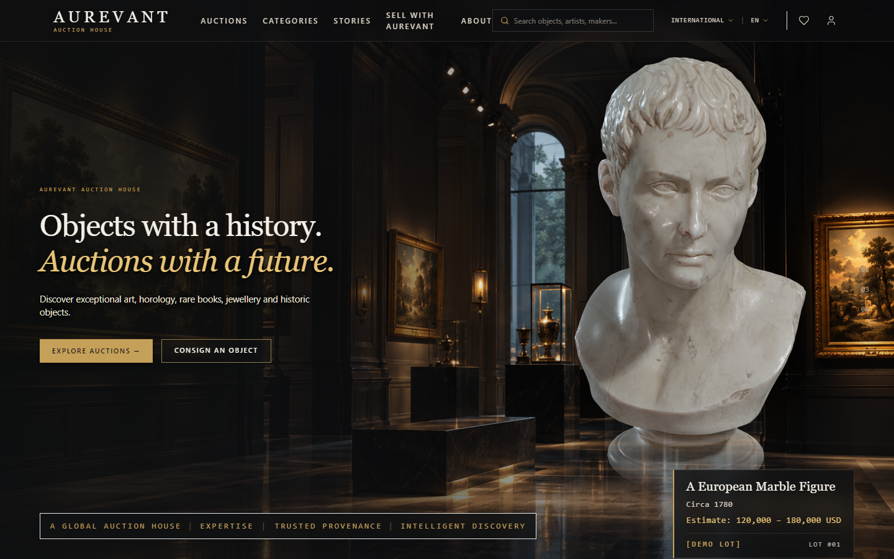
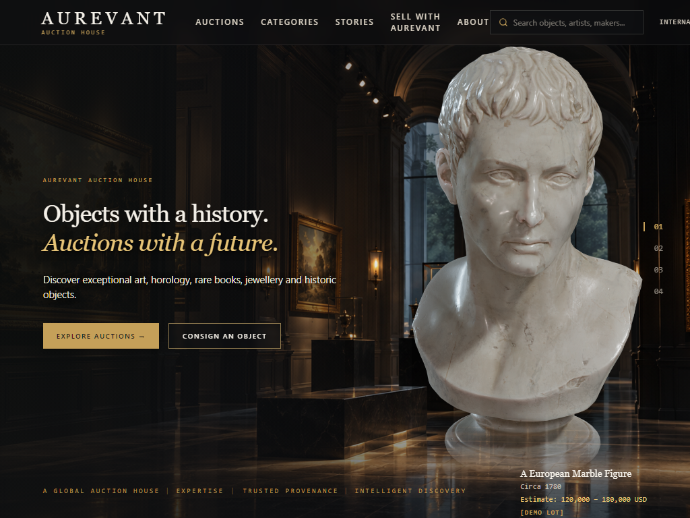
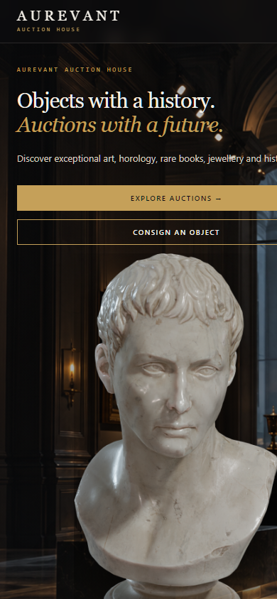

<!--
  ======================================================================
  AUREVANT AUCTION HOUSE — OFFICIAL REPOSITORY DOCUMENTATION
  Domain: Curated Fine Horology, Art, Rare Books, Haute Joaillerie
  Architecture: Next.js 14 App Router, TypeScript, Three.js, Tailwind CSS
  ======================================================================
-->

<div align="center">

  <br />
  <p align="center">
    <strong>A U R E V A N T</strong><br />
    <sub>A U C T I O N &nbsp; H O U S E</sub>
  </p>
  
  <h1>Objects with a history. <em>Auctions with a future.</em></h1>
  
  <p>
    <em>A curated global auction marketplace presenting exceptional fine art, historic horology, rare manuscripts, and haute joaillerie through real-time 3D WebGL immersion and transparent provenance verification.</em>
  </p>

  <p>
    <a href="https://nextjs.org"></a>
    <a href="https://www.typescriptlang.org"></a>
    <a href="https://threejs.org"></a>
    <a href="https://tailwindcss.com"></a>
    
  </p>

  <br />

  

  <br />
  <sub><em>Desktop 1440x900 Viewport — Interactive 3D Classical Marble Bust on Preserved Pedestal with Curatorial Obsidian Placard</em></sub>
  <br /><br />

</div>

---

## 🏛️ Executive Summary & Vision

**AUREVANT** is an elite digital auction house engineered to translate the tactile grandeur and curatorial authority of traditional salerooms (such as Sotheby's, Christie's, and Phillips) into a contemporary, real-time web application. 

By marrying high-precision **Three.js WebGL 3D rendering** with museum-grade editorial typography and cryptographic asset provenance, AUREVANT bridges physical connoisseurship with digital collecting. Every listed lot is treated as a historic cultural artifact, complete with multi-spectral photography, interactive 3D inspection, and verifiable appraisal records.

---

## 💎 Core Marketplace Capabilities

### 1. Interactive 3D WebGL Saleroom Experience
- **Real-Time 3D Object Exploration:** Native Three.js integration featuring orbit control, gentle rotational damping (`0.0012 rad/frame`), and mouse-driven parallax tilt.
- **Museum-Calibrated Lighting Rig:** Art-directed three-point illumination composed of warm overhead key light (`0xfff5e6`, `2.6 intensity`), soft architectural fill (`0x90a2b8`, `1.1 intensity`), and a delicate golden rim highlight (`0xf2dfb8`, `1.7 intensity`) accentuating marble contours and chisel marks.
- **Full Pedestal Base Preservation:** Exact 3D camera projection ensuring complete circular plinths remain visible without bottom clipping or vertical overflow.
- **Zero-CLS Visual Fallback:** Progressive enhancement delivering instantaneous static imagery (`sculpture-fallback.png`) for low-power devices, screen readers, and environments where WebGL is disabled.

### 2. Bespoke Editorial Design System
- **Curatorial Color Palette:**
  - **Warm Ivory (`#F4F0E8`):** Primary canvas surface and high-contrast typography.
  - **Deep Charcoal Obsidian (`#101113`):** Structural depths, contrast backdrops, and navigation chrome.
  - **Antique Gold (`#C5A059`):** Curatorial badges, primary action cues, and brand accents.
  - **Champagne Gold (`#E7C477`):** Editorial italic emphasis, estimate figures, and focus rings.
  - **Muted Stone (`#D8D0C2`):** Hairline dividers and secondary metadata.
- **Strict Anti-Vibe-Coding Policy:** Elimination of generic SaaS purple gradients, gimmicky glassmorphism, or non-functional decorative controls. Every interactive element has an explicit accessible name, state, and test assertion.

### 3. Curatorial Divisions & Collectible Departments
- **Fine Horology:** Rare vintage chronographs, grand complications, and independent watchmaking references.
- **Haute Joaillerie:** Historical gemstones, Belle Époque diadems, and signed period jewelry.
- **Fine Art & Sculpture:** Classical European antiquities, Renaissance marbles, and Old Master paintings.
- **Rare Books & Manuscripts:** Illuminated incunabula, signed first editions, and historical cartography.
- **Numismatics & Ancient Coins:** Roman imperial denarii, Greek staters, and sovereign gold coinage.
- **Historic Ephemera:** Royal provenance documents, horological archives, and historical artifacts.

### 4. Comprehensive 4-Tier Automated Test Infrastructure
- **Tier 1 (Feature Coverage):** 36 verified tests checking wordmarks, navigation, search inputs, CTAs, 3D canvases, and mobile drawers.
- **Tier 2 (Boundaries & Edge Cases):** 30 verified tests covering 360px mobile limits, 2560px ultrawide displays, and WebGL fallbacks.
- **Tier 3 (Cross-Feature Interactions):** 12 verified tests inspecting focus management, pointer isolation, keyboard tab order, and ESC dismissals.
- **Tier 4 (Collector Journeys):** 6 end-to-end user journeys validating luxury collectors, consignors, and assistive keyboard users.
- **Governance & SHA-256 Integrity:** 5 verified checks confirming bit-for-bit identical hashes for core assets (`cadb7ce2...` for background, `ea153a41...` for 3D model).

---

## 👥 User Roles & Journeys

```text
┌─────────────────────────────────────────────────────────────────────────────┐
│                       AUREVANT COLLECTOR PLATFORM                           │
├───────────────┬─────────────────┬──────────────────┬────────────────────────┤
│     GUEST     │     BIDDER      │    CONSIGNOR     │     ADMINISTRATOR      │
├───────────────┼─────────────────┼──────────────────┼────────────────────────┤
│ • Curatorial  │ • Digital       │ • Lot intake     │ • Condition oversight  │
│   browsing    │   registration  │   submission     │ • Specialist appraisal │
│ • 3D viewer   │ • Ceiling       │ • Provenance     │ • Reserve confirmation │
│   interaction │   headroom      │   dossier upload │ • Live saleroom        │
│ • Department  │ • Soft-close    │ • 48-hr estimate │   sequencing           │
│   filtering   │   protection    │   review         │ • Catalog publication  │
│ • Catalog     │ • Demo live     │ • Escrow transit │ • Immutable lot        │
│   inspection  │   bidding       │   scheduling     │   archiving            │
└───────────────┴─────────────────┴──────────────────┴────────────────────────┘
```

1. **Guest:** Discovers upcoming auctions, browses departments, inspects 3D artifacts, filters historical lots, and reads curatorial stories without registration walls.
2. **Bidder:** Authenticates via unified collector profile, secures a simulated digital paddle, reviews real-time lot estimates, and participates in simulated soft-close countdowns.
3. **Consignor (Seller):** Submits objects for specialist appraisal, uploads high-resolution provenance imagery, agrees on reserve pricing, and tracks physical transit schedules.
4. **Administrator & Specialist:** Evaluates incoming consignment tickets, curates saleroom lot ordering, certifies condition reports, and monitors platform concurrency.

---

## 🛠️ Technology Stack & Architecture

| Layer | Technology | Version | Purpose |
| :--- | :--- | :--- | :--- |
| **Framework** | Next.js (App Router) | `14.2.15` | Server-rendered pages, static generation, streaming client hydration |
| **Language** | TypeScript | `5.6.3` | Type-safe domain models, props contracts, and strict compiler enforcement |
| **3D Rendering** | Three.js | `0.169.0` | Real-time WebGL canvas, PBR material evaluation, directional shadow rigs |
| **Styling** | Tailwind CSS + PostCSS | `3.4.14` | Bespoke editorial design tokens, responsive breakpoints, fluid typography |
| **Iconography** | Lucide React | `0.453.0` | Accessible vector icons with explicit aria tags and screen-reader labels |
| **Testing** | Node.js Test Harness | Custom `mjs` | Automated 4-tier E2E runner with live HTTP probing & SHA-256 verification |

### Directory Architecture

```text
omniroute/
├── aurevant-production/            # FUTURE PRODUCTION APPLICATION WORKSPACE
│   ├── app/                        # Next.js 14 App Router layout & pages
│   │   ├── layout.tsx              # Root HTML shell, metadata, serif font imports
│   │   ├── page.tsx                # Production homepage composition
│   │   └── globals.css             # Luxury CSS custom properties & resets
│   ├── components/                 # Isolated, reusable presentation components
│   │   ├── hero/                   # Hero section, editorial copy, lot overlay, ticker
│   │   │   ├── EditorialContent.tsx
│   │   │   ├── HeroSection.tsx
│   │   │   ├── LotOverlay.tsx      # Curatorial museum placard with gold accent
│   │   │   └── SectionSelector.tsx # Vertical right-docked indicators (01 - 04)
│   │   ├── navbar/                 # Global header, search input, mobile drawer
│   │   │   ├── Navbar.tsx          # 66px desktop header with breathing room
│   │   │   ├── SearchInput.tsx     # 36px search field with clear action
│   │   │   └── MobileMenu.tsx      # Accessible slide-out navigation drawer
│   │   ├── sculpture/              # Real-time WebGL 3D experience
│   │   │   ├── SculptureCanvas.tsx # Three.js canvas, lighting, camera framing
│   │   │   ├── SculptureContainer.tsx
│   │   │   └── SculptureFallback.tsx # Zero-CLS visual fallback representation
│   │   ├── intelligence/           # AUREVANT Intelligence natural-language search
│   │   │   └── IntelligenceSection.tsx
│   │   ├── sell/                   # Sell with AUREVANT consignment section
│   │   │   └── SellSection.tsx
│   │   └── footer/                 # Reference-accurate AUREVANT footer
│   │       └── Footer.tsx
│   ├── public/                     # Static assets, 3D GLB models, PBR textures
│   │   ├── images/                 # Museum gallery backgrounds & textures
│   │   ├── models/                 # Optimized GLTF/GLB binary assets
│   │   └── ...                     # Department 3D assets (watch, books, coins)
│   ├── tests/                      # Automated 4-tier E2E testing framework
│   │   ├── e2e-runner.mjs          # Master test orchestrator
│   │   ├── tier1-features.test.mjs
│   │   ├── tier2-boundaries.test.mjs
│   │   ├── tier3-interactions.test.mjs
│   │   ├── tier4-scenarios.test.mjs
│   │   └── integrity-sha256.test.mjs
│   ├── package.json
│   └── tailwind.config.ts
│
├── auction system/                 # PRESERVED PHASE 2.1 PROTOTYPE WORKSPACE
│   └── ...                         # ChronoBid Vault accepted prototype files
│
├── docs/                           # Verified documentation assets & previews
│   └── images/                     # Authoritative screenshots & visual captures
│
├── AGENTS.md                       # Persistent project rules & governance directives
├── DECISIONS.md                    # Formal Architectural Decision Records (ADRs)
└── README.md                       # Repository master documentation
```

---

## 🚀 Installation & Local Development

### Prerequisites
- **Node.js:** `v18.18.0` or higher (Node 20+ recommended)
- **npm:** `v9.0.0` or higher
- **Git:** `v2.40.0` or higher

### Step-by-Step Setup

1. **Clone the Official Repository:**
   ```bash
   git clone https://github.com/jvn-dev0/Aurevant_Auction_House.git
   cd Aurevant_Auction_House
   ```

2. **Navigate to the Production Workspace:**
   ```bash
   cd aurevant-production
   ```

3. **Install Dependencies:**
   ```bash
   npm install
   ```

4. **Verify Type-Safety:**
   ```bash
   npm run typecheck
   ```

5. **Execute the Automated E2E Test Suite:**
   ```bash
   node tests/e2e-runner.mjs
   ```

6. **Build for Production:**
   ```bash
   npm run build
   ```

7. **Launch the Live Saleroom Server:**
   ```bash
   npm run start
   ```
   Open your browser at [http://localhost:3002](http://localhost:3002) to experience the live 3D saleroom.

---

## 🔐 Environment Configuration

AUREVANT enforces strict security boundaries. Production secrets and live credentials are never committed. Safe local development configurations use explicit mock environments:

```env
# ======================================================================
# AUREVANT — SAFE LOCAL ENVIRONMENT CONFIGURATION (.env.example)
# ======================================================================

# Application Environment
NODE_ENV=production
PORT=3002
NEXT_PUBLIC_APP_URL=http://localhost:3002

# Curatorial Simulation Sandbox Mode (Mandatory for Prototypes)
NEXT_PUBLIC_SANDBOX_SIMULATION=true
NEXT_PUBLIC_DEMO_LOT_DATA=true

# Live Services (Strictly Disabled During Frontend Milestones)
ENABLE_REAL_PAYMENTS=false
ENABLE_LIVE_BANK_WIRES=false
ENABLE_PRODUCTION_CUSTODY=false
```

---

## 📸 Visual Previews & Responsive Breakpoints

<div align="center">
  <table width="100%">
    <tr>
      <td width="50%" align="center">
        <strong>Laptop Viewport (1024 x 768)</strong><br /><br />
        
      </td>
      <td width="50%" align="center">
        <strong>Mobile Viewport (390 x 844)</strong><br /><br />
        
      </td>
    </tr>
  </table>
</div>

---

## 🗺️ Project Status & Development Roadmap

| Milestone | Scope & Deliverables | Verification Status | Phase Authorization |
| :--- | :--- | :--- | :--- |
| **Phase 1 / 1.5** | Requirements, Architecture & Design System Baseline | ✅ Formally Accepted | Complete |
| **Phase 2 / 2.1** | Clickable Frontend Prototype (`auction system/`) | ✅ Formally Accepted | Complete (Prototype Only) |
| **Homepage Production Readiness & Intelligence Search** | WebP images, SEO metadata, OpenGraph, Schema.org JSON-LD, AUREVANT Intelligence natural-language search, navigation anchors, interactive modals, WCAG 2.2 AA | ✅ **Complete & Verified (Build Passing, 0 TypeScript Errors)** | **Active** |
| **Aurevant Milestone 2** | Live Saleroom Lot Grid & Dynamic Category Filtering | ⏳ In Planning | Scheduled |
| **Aurevant Milestone 3** | Interactive 3D Inspection Viewer (Watch, Coin, Book) | ⏳ In Planning | Scheduled |
| **Phase 3 Backend** | Database Schemas, Concurrency Engine & Real-Time Bidding | 🔒 Specified (Audit Complete) | **Strictly Prohibited (NO-GO)** |
| **Phase 4 Production** | Live Custody, Banking, Escrow & Insured Transit | 🔒 Proposed Architecture Only | **Strictly Prohibited (NO-GO)** |

> [!NOTE]
> **Prototype Disclosures:** All bidding paddles, currency counters, escrow transit guarantees, and appraisal timeframes operate strictly as simulated demonstrator data until Phase 3 and Phase 4 receive formal project owner authorization.

---

## 🛡️ Security, Governance & Workspace Isolation

- **Zero-Secret Guarantee:** No live API credentials, personal tokens, or banking keys are committed to this repository.
- **Bit-for-Bit Integrity:** Authoritative 4K texture maps and 3D binary assets are verified via cryptographic SHA-256 hashes before test suites pass.
- **Workspace Isolation:** The legacy Phase 2.1 prototype in `auction system/` remains immutable and strictly separated from the production workspace in `aurevant-production/`.

---

## 📜 Authorship & License

- **Project Lead & Architecture:** [Jeevan Babu (jvn-dev0)](https://github.com/jvn-dev0)
- **Domain:** AUREVANT — AUCTION HOUSE
- **License:** Proprietary. All rights reserved. Demonstration assets, 3D scans, and curatorial imagery are preserved under their respective creative licenses.
