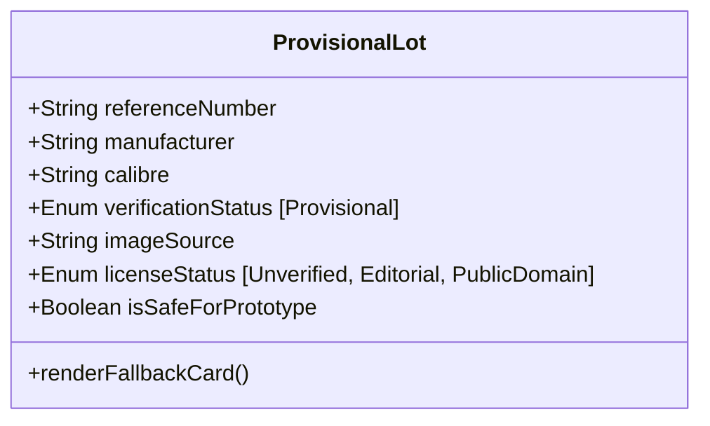

# ChronoBid Vault — Prototype Asset & Image-Rights Readiness

> [!CAUTION]
> ### 🚨 STRICT NO-CODING RULE IN EFFECT — IMPLEMENTATION ABSOLUTELY PROHIBITED
> **The project owner has NOT authorised coding or Phase 2.**  
> This document specifies asset governance, licensing requirements, and provenance audit registers for planning and verification purposes ONLY. It does NOT authorise downloading external assets, modifying website files, or beginning implementation.
> 
> - **Phase 1 Status:** `FORMALLY APPROVED AS PROJECT BASELINE (v2.2 — 2026-10-17)`  
> - **Prototype Preparation:** `DOCUMENTATION ONLY`  
> - **Implementation Status:** `BLOCKED — AWAITING EXPLICIT PROJECT OWNER AUTHORISATION`  
> - **Phase 2 Status:** **`NOT AUTHORISED — CODING PROHIBITED`**

---

## 1. Executive Summary & Asset Governance Baseline

The **Prototype Asset & Image-Rights Readiness Register** establishes the strict evidentiary and licensing criteria governing all visual assets within ChronoBid Vault.

In alignment with **ADR-009**, **ADR-014**, and **Section 8** of the approved Phase 1 Specification:
1. **Zero Invented Assets:** No fabricated image URLs, hotlinks to unverified third-party hosts, or AI-generated watch approximations claiming to be authentic museum specimens may be used.
2. **Provisional Baseline Retained:** All six marquee debut timepieces remain strictly **`PROVISIONAL`** until exact reference specifications, museum archival provenance records, and high-resolution licensing agreements are fully verified.
3. **Mandatory Overlays & Labeling:** Every visual fixture representing a demonstration timepiece must carry visible `[PROVISIONAL DEMO SPECIMEN]` and `[DEMO DATA]` labels.
4. **Resilient Monogram Fallback:** Any asset lacking verified commercial/editorial licensing or failing to load must render the approved `#EDE7DC` monogram fallback card, preserving container aspect ratios and eliminating Cumulative Layout Shift (CLS < 0.02).
5. **No Third-Party Asset Ingestion:** No external images or media files are downloaded, modified, or introduced during this documentation task.

---

## 2. Central Image Manifest Specification (`IMAGE_MANIFEST.md`)

Every image asset intended for future inclusion in ChronoBid Vault must be formally registered in a dedicated `IMAGE_MANIFEST.md` table adhering to the schema defined in Phase 1 Spec §8.1:

| Column Header | Requirement Description | Validation Rule |
| :--- | :--- | :--- |
| `Filename` | Exact relative repository path | Must resolve within `/images/lots/` or `/images/editorial/` |
| `Listing / Category` | Associated horological lot or section | Must match an approved lot reference or section title |
| `Source / Method` | Originating archive or photographic studio | Verifiable institutional, museum, or studio citation |
| `Usage Rights` | Verified legal licensing status | Documented CC license, museum public domain release, or written editorial release |
| `Alt Text` | Descriptive, accessible text description | Exhaustive horological detail (dial, bezel, hands, metal, calibre) |
| `Approval Status` | Project Owner review status | Must be `Approved`, `Provisional`, or `Awaiting Clearance` |

---

## 3. Asset-Readiness Register: The Six Provisional Debut Timepieces

Each of the six provisional timepieces proposed for the ChronoBid Vault debut catalog is audited below across its horological specification, provenance source, licensing status, required evidence, fallback behavior, and prototype safety assessment.



---

### Lot 01: 1968 Patek Philippe Calatrava Ref. 3520D (Yellow Gold)

- **Horological Metadata:**
  - Manufacturer: Patek Philippe (Geneva, Switzerland).
  - Reference: Ref. 3520D (Clous de Paris / Hobnail Bezel).
  - Production Year: Circa 1968.
  - Movement / Calibre: Ultra-thin manual-wind Calibre 175 (18 jewels, 21,600 vph, Gyromax balance).
  - Case Metal & Dimensions: 18k Yellow Gold, 32.5mm diameter, 5.5mm depth.
  - Dial & Hands: White lacquered porcelain dial, black Roman numerals, black blackened-gold baton hands.
- **Verification Status:** **`PROVISIONAL`** (Retained per Project Owner Sign-Off Gate).
- **Image Source & Provenance Status:**
  - Proposed Source: Swiss horological museum archival collection or public domain saleroom archive.
  - Current Provenance Record: Archival extract pending; physical specimen chain of custody unverified.
- **Usage & Licensing Status:** **Unverified / Awaiting Rights Clearance**.
  - No high-resolution commercial or editorial license currently cleared for production use.
- **Required Evidence for Full Clearance:**
  1. High-resolution multi-angle studio photography (Dial, Bezel, Calibre 175, Caseback hallmarks).
  2. Institutional museum rights release or Creative Commons CC-BY 4.0 / CC0 verification.
  3. Patek Philippe Extract from the Archives confirming reference 3520D movement serial ranges.
- **Approved Fallback Behavior:**
  - If licensed imagery is unavailable during prototype launch, render the `#EDE7DC` monogram fallback card:
    - Display centered monogram `PP` in `Instrument Serif` (32px).
    - Label `REF. 3520D — CAL. 175` in `IBM Plex Mono` (11px).
    - Subtext: *"Archival specimen photograph currently undergoing provenance review."*
    - Aspect ratio locked to `4:5` portrait (CLS = 0.00).
- **Prototype Safety Assessment:**
  - **Conditionally Safe for Prototype:** Permitted in clickable demo prototype ONLY with mandatory `[PROVISIONAL DEMO SPECIMEN]` and `[DEMO DATA]` badges. If rights clearance remains unverified at implementation time, the `#EDE7DC` monogram card must be used.

---

### Lot 02: 1972 Audemars Piguet Royal Oak Ref. 5402ST "A-Series"

- **Horological Metadata:**
  - Manufacturer: Audemars Piguet (Le Brassus, Switzerland).
  - Reference: Ref. 5402ST (Original Gérald Genta design, "A-Series" with AP logo at 6 o'clock).
  - Production Year: Circa 1972 (First production run of 1,000 units).
  - Movement / Calibre: Ultra-thin automatic Calibre 2121 (Jaeger-LeCoultre base 920, 21k gold rotor segment, 19,800 vph).
  - Case Metal & Dimensions: Hand-finished stainless steel with octagonal bezel and 8 hexagonal white gold screws, 39mm "Jumbo" diameter, 7mm depth.
  - Dial & Hands: Dark charcoal *Petite Tapisserie* guilloché dial, applied luminous baton hour markers, AP monogram at 6 o'clock.
- **Verification Status:** **`PROVISIONAL`** (Retained per Project Owner Sign-Off Gate).
- **Image Source & Provenance Status:**
  - Proposed Source: Horological archive or independent collector provenance documentation.
  - Current Provenance Record: Exact individual case/movement serial number pending audit.
- **Usage & Licensing Status:** **Unverified / Awaiting Rights Clearance**.
- **Required Evidence for Full Clearance:**
  1. Photographic rights release for macro views of the *Petite Tapisserie* dial and Calibre 2121 rotor.
  2. Verification of A-series serial number stamping on exterior caseback (A1 through A2000 range).
  3. Audemars Piguet Heritage Department certificate confirmation.
- **Approved Fallback Behavior:**
  - Render `#EDE7DC` fallback card with centered `AP` monogram, `REF. 5402ST — CAL. 2121`, and archival subtext; aspect ratio locked to `4:5`.
- **Prototype Safety Assessment:**
  - **Conditionally Safe for Prototype:** Permitted in prototype with `[PROVISIONAL DEMO SPECIMEN]` overlay. Reverts to monogram fallback if imagery rights are unconfirmed.

---

### Lot 03: 1965 Rolex Daytona Cosmograph Ref. 6239 "Paul Newman"

- **Horological Metadata:**
  - Manufacturer: Rolex (Geneva, Switzerland).
  - Reference: Ref. 6239 (Stainless steel tachymeter bezel, pump pushers).
  - Production Year: Circa 1965.
  - Movement / Calibre: Manual-wind Valjoux 722 chronograph (17 jewels, 18,000 vph, column wheel).
  - Case Metal & Dimensions: Stainless steel, 36.5mm diameter, 12mm depth.
  - Dial & Hands: Exotic three-color dial (white/cream dial with black step sub-dials, art deco square font numerals, crosshairs, red Daytona script and outer track).
- **Verification Status:** **`PROVISIONAL`** (Retained per Project Owner Sign-Off Gate).
- **Image Source & Provenance Status:**
  - Proposed Source: Archival saleroom reference collection.
  - Current Provenance Record: Dial authenticity and step-register parameters uncertified.
- **Usage & Licensing Status:** **Unverified / High Risk of Copyright Claims**.
  - Historical Rolex and saleroom imagery is aggressively protected; strict licensing verification is mandatory.
- **Required Evidence for Full Clearance:**
  1. Written editorial license release from the original copyright holder or authorized saleroom archive.
  2. Microscopic dial inspection verifying authentic Singer step-plate construction and original tritium patina.
  3. Movement serial and bridge stamping ("722") archival records.
- **Approved Fallback Behavior:**
  - Render `#EDE7DC` fallback card with `ROLEX` crown or monogram mark, `REF. 6239 — CAL. 722`, and provenance review notice; aspect ratio `4:5`.
- **Prototype Safety Assessment:**
  - **High Scrutiny Asset:** Safe for internal prototype demonstration ONLY when explicitly badged `[PROVISIONAL DEMO SPECIMEN]`. Must NOT be deployed on any public-facing URL without cleared rights; monogram fallback is the recommended default.

---

### Lot 04: 1957 Omega Speedmaster Ref. CK 2915-1 "Broad Arrow"

- **Horological Metadata:**
  - Manufacturer: Omega (Bienne, Switzerland).
  - Reference: Ref. CK 2915-1 (First Speedmaster generation, "Broad Arrow" hands, steel bezel).
  - Production Year: Circa 1957.
  - Movement / Calibre: Manual-wind Calibre 321 (Lemania 2310 base, 17 jewels, column-wheel chronograph, 18,000 vph).
  - Case Metal & Dimensions: Stainless steel, 38.5mm diameter, straight lugs, no crown guards.
  - Dial & Hands: Matte black dial, luminous radium hour markers, polished steel Broad Arrow hour and minute hands, Base 1000 engraved steel tachymeter bezel.
- **Verification Status:** **`PROVISIONAL`** (Retained per Project Owner Sign-Off Gate).
- **Image Source & Provenance Status:**
  - Proposed Source: Museum archive or open-access horological collection.
  - Current Provenance Record: Archival extract from Omega Museum pending.
- **Usage & Licensing Status:** **Unverified / Awaiting Rights Clearance**.
- **Required Evidence for Full Clearance:**
  1. Photographic clearance covering the engraved steel Base-1000 bezel and Calibre 321 lateral clutch.
  2. Omega Museum Extract from the Archives confirming delivery date and reference CK 2915-1 specification.
- **Approved Fallback Behavior:**
  - Render `#EDE7DC` fallback card with `Ω` monogram, `REF. CK 2915-1 — CAL. 321`, and archival subtext; aspect ratio `4:5`.
- **Prototype Safety Assessment:**
  - **Conditionally Safe for Prototype:** Permitted in prototype with `[PROVISIONAL DEMO SPECIMEN]` badge; fallback card ready for deployment.

---

### Lot 05: 1928 Cartier Tank Cintrée Dual-Time (Platinum)

- **Horological Metadata:**
  - Manufacturer: Cartier (Paris / London / European Watch and Clock Co.).
  - Reference: Tank Cintrée Dual-Time (Curved elongated case, twin independent movements).
  - Production Year: Circa 1928.
  - Movement / Calibre: Twin manual-wind European Watch & Clock Co. (EWC) mechanical calibres (each with dedicated winding crown at 2 and 4 o'clock).
  - Case Metal & Dimensions: Platinum 950 with sapphire cabochon crowns, 23mm width x 46mm curved length.
  - Dial & Hands: Dual independent silvered guilloché dials, Roman numerals, blued steel Breguet hands.
- **Verification Status:** **`PROVISIONAL`** (Retained per Project Owner Sign-Off Gate).
- **Image Source & Provenance Status:**
  - Proposed Source: Cartier Collection archival retrospective or historical private collection.
  - Current Provenance Record: Twin movement serial pairing unverified.
- **Usage & Licensing Status:** **Unverified / Awaiting Rights Clearance**.
- **Required Evidence for Full Clearance:**
  1. Image rights license for curved profile and dual-crown architecture.
  2. Certificate of authenticity from Cartier Heritage Department confirming 1928 manufacture.
  3. EWC movement registry confirmation for both calibres.
- **Approved Fallback Behavior:**
  - Render `#EDE7DC` fallback card with `CARTIER` monogram, `REF. TANK CINTRÉE DUAL-TIME (1928)`, and archival subtext; aspect ratio `4:5`.
- **Prototype Safety Assessment:**
  - **Conditionally Safe for Prototype:** Permitted in prototype with `[PROVISIONAL DEMO SPECIMEN]` badge; fallback card ready.

---

### Lot 06: 1999 A. Lange & Söhne Datograph Ref. 403.035 (Platinum / Black Dial)

- **Horological Metadata:**
  - Manufacturer: A. Lange & Söhne (Glashütte, Germany).
  - Reference: Ref. 403.035 (First-generation Datograph, "Puffi" platinum case with black dial and silver registers).
  - Production Year: Circa 1999.
  - Movement / Calibre: In-house manual-wind Calibre L951.1 (405 components, 40 jewels, flyback chronograph, outsize date, Glashütte stripes, hand-engraved balance cock).
  - Case Metal & Dimensions: Platinum 950, 39mm diameter, 12.8mm depth, rectangular date pusher at 10 o'clock.
  - Dial & Hands: Solid silver black dial, rhodiumed gold luminous baton indices, outsize date window at 12 o'clock, sunken silver sub-dials.
- **Verification Status:** **`PROVISIONAL`** (Retained per Project Owner Sign-Off Gate).
- **Image Source & Provenance Status:**
  - Proposed Source: German horological collection or authorized saleroom retrospective.
  - Current Provenance Record: First-generation L951.1 calibre finishing uninspected.
- **Usage & Licensing Status:** **Unverified / Awaiting Rights Clearance**.
- **Required Evidence for Full Clearance:**
  1. High-resolution macro photography of the three-dimensional movement architecture, column wheel, and engraved balance cock.
  2. License agreement from photographer or museum collection.
  3. A. Lange & Söhne archival registration certificate.
- **Approved Fallback Behavior:**
  - Render `#EDE7DC` fallback card with `LANGE` monogram, `REF. 403.035 — CAL. L951.1`, and archival subtext; aspect ratio `4:5`.
- **Prototype Safety Assessment:**
  - **Conditionally Safe for Prototype:** Permitted in prototype with `[PROVISIONAL DEMO SPECIMEN]` badge; fallback card ready.

---

## 4. Master Asset-Readiness Summary Table

| Lot # | Proposed Timepiece Reference | Calibre | Provenance Status | Rights Status | Prototype Safe? | Fallback Card Ready? |
| :---: | :--- | :--- | :--- | :--- | :---: | :---: |
| **01** | Patek Philippe Calatrava 3520D | Cal. 175 | Archival Pending | Unverified | **Conditional** (with demo label) | **Yes** (`#EDE7DC`) |
| **02** | Audemars Piguet Royal Oak 5402ST | Cal. 2121 | Serial Unverified | Unverified | **Conditional** (with demo label) | **Yes** (`#EDE7DC`) |
| **03** | Rolex Daytona Cosmograph 6239 | Cal. 722 | Dial Uncertified | High Risk | **High Scrutiny** (Monogram Preferred) | **Yes** (`#EDE7DC`) |
| **04** | Omega Speedmaster CK 2915-1 | Cal. 321 | Archival Pending | Unverified | **Conditional** (with demo label) | **Yes** (`#EDE7DC`) |
| **05** | Cartier Tank Cintrée Dual-Time | Twin EWC | Twin Serial Unverified | Unverified | **Conditional** (with demo label) | **Yes** (`#EDE7DC`) |
| **06** | A. Lange & Söhne Datograph 403.035 | Cal. L951.1 | Archive Pending | Unverified | **Conditional** (with demo label) | **Yes** (`#EDE7DC`) |

---

## 5. Fallback Monogram Implementation Rules

To satisfy **ADR-024** and **Phase 1 Spec §8.4**, the fallback card implementation must satisfy every technical rule below when activated in the future prototype:

1. **DOM Structure:**
   ```html
   <div class="relative flex flex-col items-center justify-center bg-[#EDE7DC] border border-[#D8D0C2] aspect-[4/5] w-full p-6 text-center select-none">
     <div class="font-serif italic text-3xl text-[#182720] tracking-tight mb-2">
       [Manufacturer Monogram]
     </div>
     <div class="font-mono text-[11px] uppercase tracking-widest text-[#182720] font-semibold mb-3">
       [Reference ID] &bull; [Calibre]
     </div>
     <p class="font-sans text-xs text-[#6C7D75] leading-relaxed max-w-[200px]">
       Archival specimen photograph currently undergoing provenance review.
     </p>
     <span class="sr-only">Archival placeholder for [Manufacturer] [Model] [Reference]</span>
   </div>
   ```
2. **CLS Elimination:** Container styles must explicitly define aspect ratio (`aspect-[4/5]` for cards, `aspect-[16/9]` for hero/interludes) so the layout does not reflow or jump when replacing a broken image URL (Cumulative Layout Shift < 0.02).
3. **Screen Reader Accessibility:** The hidden `<span class="sr-only">` element ensures visually impaired users are informed of the watch model and reference even when the visual image is replaced by a fallback monogram.
4. **Visual Hierarchy:** Background must use Stone Surface `#EDE7DC`, typography in Deep Forest `#182720` and muted slate `#6C7D75`, with zero neon or unbranded styling.

---

## 6. Prohibited Actions & Strict Governance Rules

1. **NO DOWNLOADS:** Do NOT download, scrape, hotlink, or store unverified third-party images in the workspace during prototype preparation.
2. **NO INVENTED PROVENANCE:** Do NOT describe provisional specimens as certified, inspected, or physically possessed by ChronoBid Vault.
3. **NO STOCK AUTHENTICATION:** Stock photography must never be presented as physical proof of mechanical condition.
4. **STRICT PRESERVATION OF PROVISIONAL STATUS:** The provisional status of all 6 references must remain locked until explicit Project Owner approval and rights clearance.
