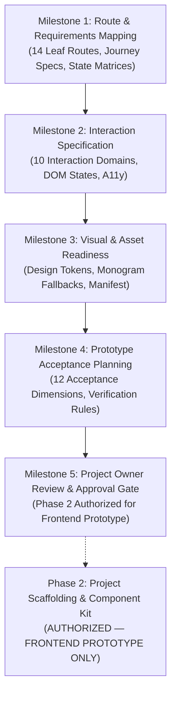

# ChronoBid Vault — Phase 1.5 Prototype Readiness Plan

> [!NOTE]
> ### 🏛️ PHASE 2 AUTHORIZATION GRANTED — CLICKABLE FRONTEND PROTOTYPE ONLY
> **The project owner has explicitly authorized Phase 2 (2026-10-18), strictly limited to building the clickable frontend website prototype.**  
> On 2026-10-19, the Project Owner issued the Phase 1 Specification Amendment ("Multi-Category Auction Marketplace and Pre-Funded Vault Controls"), formally incorporated as Version 2.3.
> 
> - **Phase 1 Status:** `FORMALLY APPROVED (BASELINE v2.2 — 2026-10-17) WITH AMENDMENT (v2.3 — 2026-10-19)`  
> - **Phase 2 Status:** **`AUTHORIZED (Clickable Frontend Prototype Only — In Progress)`**  
> - **Phase 3+ Status:** **`NOT AUTHORISED — PRODUCTION BACKEND & LIVE PAYMENTS STRICTLY PROHIBITED`**

---

## 1. Executive Summary & Purpose

The **Phase 1.5 Prototype Readiness Plan** translates the formally approved *Phase 1 Requirements & Design Specification (v2.2 baseline approved 2026-10-17; v2.3 amendment incorporated 2026-10-19)* into a comprehensive, verifiable roadmap for building an interactive, clickable frontend prototype authorized under Phase 2.

This document establishes:
1. Complete page-by-page readiness specifications covering all 14 approved leaf URLs (12 primary page specifications, /auth/verify-email documented as a stepped subflow under Route 12, and /auth/reset-password documented in its dedicated standalone specification section), incorporating multi-category catalogue browsing and pre-funded Vault balance displays.
2. Exact state transition matrices (default, loading, empty, error, success, unavailable) for every screen.
3. Visual identity and design token mappings strictly adhering to the approved editorial-parallax aesthetic.
4. Technical architecture prerequisites, external dependencies, and unapproved draft assumptions.
5. Structured milestones, dependencies, and completion criteria leading to the formal Phase 2 approval gate.

---

## 2. Approved Route Architecture & Page Readiness Specifications

The ChronoBid Vault prototype encompasses 14 approved leaf-page URLs structured within the Next.js App Router architecture, accompanied by 3 redirecting parent route segments and 3 shared layout segments. Documented below are the page readiness specifications covering all 14 approved leaf URLs (12 primary page specifications, /auth/verify-email documented as a stepped subflow under Route 12, and /auth/reset-password documented in its dedicated standalone specification).

```
/                                   (Route 01: Approved 11-section editorial homepage)
├── /auctions
│   ├── /auctions/live              (Route 02: Active demonstration salerooms)
│   ├── /auctions/upcoming          (Route 03: Preview catalog with registration)
│   └── /auctions/lots/[lotSlug]    (Route 04: Deep lot inspection & demo bidding)
├── /how-it-works                   (Route 05: Buyer & consignor procedural guide)
├── /transparency                   (Route 06: Condition audit & inspection standards)
├── /consign                        (Route 07: Multi-step intake dossier & valuation)
├── /account                        (Unified collector portal)
│   ├── /account/bids               (Route 08: Active demo bids & watchlist)
│   ├── /account/consignments       (Route 09: Submitted watches & appraisal tracking)
│   └── /account/settings           (Route 10: Profile preferences & demo paddle)
└── /auth
    ├── /auth/login                 (Route 11: Email/Password authentication)
    ├── /auth/register              (Route 12: Signup with intent selection)
    ├── /auth/verify-email          (Rendered leaf URL 13: Simulated PIN confirmation subflow; sufficiently documented; Spec §5.6)
    └── /auth/reset-password        (Rendered leaf URL 14: Password recovery flow; Spec §5.5; Route 14 specification)
```

---

### Route 01: `/` (Homepage)

- **Page Purpose & Intended User:** Curated gateway to ChronoBid Vault for exploring guests, returning collectors, and prospective consignors. Establishes horological prestige, presents the editorial narrative, showcases marquee timepieces, and introduces the demonstration auction saleroom.
- **Primary User Action:** Explore the curated collection (Section 5) and inspect or enter the featured live demonstration saleroom (Section 7).
- **Required Content & Interface Sections (Approved 11-Section Editorial Order):**
  1. *Announcement Strip:* Global broadcast ticker with live status indicator and multi-currency selector.
  2. *Header / Navigation:* Brand wordmark, primary route links, currency switch, and auth trigger ("Join / Sign In" or assigned Paddle badge).
  3. *Hero Section:* High-contrast typography (*"Objects worth waiting for."* in 88–112px `Instrument Serif`), tactile paper texture, and hero timepiece macro.
  4. *Editorial Narrative:* Monograph commentary on mechanical provenance and archival curation.
  5. *Curated Vault Collection:* 3-column asymmetric grid displaying 6 provisional lots with working category filter tabs (*All Specimens, Chronographs, Dress & Ultra-Thin, Historic Divers, Complications*).
  6. *Editorial Interlude:* Edge-to-edge Deep Forest (`#182720`) container with balance-wheel macro and italic pull-quote.
  7. *Featured Live Saleroom Demonstration:* Dual-pane saleroom container with studio imagery, live soft-close countdown, real-time bid log, and interactive demo bidding console.
  8. *How It Works:* 4-step architectural breakdown clearly designating *Escrow Custody* and *Insured Transit* as `[PROPOSED FUTURE SERVICE — NOT OPERATIONAL]`.
  9. *Trust & Transparency:* Three pillars of verification (provable provenance, independent mechanical audit, and sandbox transparency).
  10. *Final Invitation:* Dual conversion cards targeting prospective bidders and prospective consignors.
  11. *Footer:* Horological colophon, legal terms, accessibility statement, and persistent sandbox disclaimer.
- **Navigation Paths:**
  - *Entry:* Direct URL, external referral, or brand wordmark click from any subpage.
  - *Exit:* Links to `/auctions/live`, `/auctions/upcoming`, `/auctions/lots/[lotSlug]`, `/how-it-works`, `/transparency`, `/consign`, `/auth/login`, and `/account`.
- **Authentication & Role Requirements:** Public access. No authentication required for viewing. State-modifying actions ("Place Bid", "Save to Watchlist", "Consign") open the authentication drawer or redirect to `/auth/login` with redirect context preserved.
- **State Variations:**
  - *Default:* Full 11-section editorial layout populated with 6 provisional demo fixtures.
  - *Loading:* Initial server-rendered skeleton maintaining layout boundaries (CLS < 0.02).
  - *Category Filter Empty State:* If a filter yields zero lots, displays centered `Clock` icon, message *"No specimens currently cataloged in this classification."*, and a `Reset All Filters` button.
  - *Error:* Graceful fallback card (`#EDE7DC`) if lot images fail to load.
- **Responsive Behavior:**
  - *Desktop (≥1024px):* 12-column grid, split-pane saleroom, 3-column collection grid, horizontal How-It-Works layout.
  - *Tablet (768px–1023px):* 8-column grid, 2-column collection, 2x2 How-It-Works grid, stacked saleroom.
  - *Mobile (<768px):* 4-column layout, single-column collection with horizontal scroll option, vertical step accordion, and pinned 56px bottom mobile sticky bidding bar upon scrolling past Section 7.
- **Approved Acceptance Criteria:**
  - [Phase 1 Spec §6.1, §7.2, §8.4, §12.3] 11 sections in strict sequential order; zero horizontal overflow across 6 breakpoints; CLS < 0.02; image fallback renders monogram card preserving 4:5 ratio; mobile sticky bar pins on mobile.

---

### Route 02: `/auctions/live` (Active Demonstration Salerooms)

- **Page Purpose & Intended User:** Real-time demonstration saleroom overview for registered bidders and exploring collectors seeking to observe or participate in active simulated auctions.
- **Primary User Action:** Select an active saleroom lot to monitor countdowns, review simulated counter-bidding, and place demonstration bids.
- **Required Content & Interface Sections:**
  - *Saleroom Masthead:* Active saleroom status banner with pulsating Acid Lime indicator (`● SALEROOM ACTIVE [DEMO]`), current time in UTC/Geneva, and sound toggle.
  - *Featured Saleroom Marquee:* Large-format lot view with multi-angle studio gallery, countdown clock in `IBM Plex Mono`, current ask, and bid control.
  - *Simulated Bid Activity Feed:* Live stream of anonymous bids (`Paddle #4102`, `Paddle #1890`) with timestamps and bid amounts.
  - *Concurrent Salerooms Grid:* Secondary active lots currently under hammer with live mini-clocks and quick-bid triggers.
  - *Anti-Sniping Disclosure Notice:* Explicit explanation of the configurable 120-second soft-close timer extension rule.
- **Navigation Paths:**
  - *Entry:* Primary navigation "Salerooms" link, Section 7 CTA on homepage, or lot page live link.
  - *Exit:* Click lot card to `/auctions/lots/[lotSlug]`, or navigate back to `/`.
- **Authentication & Role Requirements:** Publicly visible. Observing bids is unauthenticated. Placing a bid requires an active member session with an assigned demo paddle number. Unauthenticated bid attempts open the auth modal.
- **State Variations:**
  - *Default:* Active lots displaying counting-down timers, live bids, and interactive buttons.
  - *Soft-Close Extension Active:* Countdown turns Acid Lime with badge `[SOFT-CLOSE EXTENDED +120s]`.
  - *Saleroom Paused:* Specialist pause banner displayed if auctioneer simulation halts lot.
  - *Lot Closed / Hammer Fell:* Bidding disabled; hammer price displayed with badge `[SIMULATED HAMMER FELL]`.
  - *Empty State:* *"No active salerooms currently under the hammer. View upcoming catalog."*
- **Responsive Behavior:** Dual-column saleroom on desktop; stacked stream on mobile with sticky bottom bidding bar.
- **Approved Acceptance Criteria:**
  - [Phase 1 Spec §4.2, §10.1, §12.3] Soft-close extension extends deadline by 120 seconds if bid placed in final 120 seconds; outbid alerts announce via `aria-live="polite"`.

---

### Route 03: `/auctions/upcoming` (Upcoming Preview Catalog)

- **Page Purpose & Intended User:** Catalog showcase of upcoming auction lots for collectors planning future bids and registering for paddles.
- **Primary User Action:** Filter upcoming timepieces by era/complication, inspect catalogue notes, and click "Register Paddle for Lot".
- **Required Content & Interface Sections:**
  - *Catalog Header:* Editorial introduction to upcoming seasonal sale (e.g., *"The Geneva Autumn Collection [DEMO]"*).
  - *Faceted Filter Sidebar / Drawer:* Multi-criteria filter controls:
    - Manufacturer (Patek Philippe, Rolex, Audemars Piguet, Omega, Cartier, A. Lange & Söhne).
    - Era (Pre-1950, 1950s–1960s, 1970s–1980s, Neo-Vintage 1990s+).
    - Complication (Chronograph, Perpetual Calendar, Dual-Time, Ultra-Thin).
    - Case Metal (Yellow Gold, Platinum, Stainless Steel).
  - *Catalog Grid:* 3-column card grid displaying lot number, manufacturer, model, reference, estimate range, opening bid, and countdown to saleroom opening.
  - *Registration Callout Card:* Persistent invitation for prospective bidders to complete registration before saleroom commences.
- **Navigation Paths:**
  - *Entry:* Primary navigation "Upcoming", homepage catalog filter links.
  - *Exit:* Individual lot link `/auctions/lots/[lotSlug]`, `/auth/register`.
- **Authentication & Role Requirements:** Public access. Registering for a paddle or saving to watchlist requires login.
- **State Variations:**
  - *Default:* Full catalog grid with interactive filter chips.
  - *Filtering / Loading:* Subtle cross-fade (180–260ms) with skeleton cards.
  - *Zero Filter Results:* Editorial empty state with reset button.
- **Responsive Behavior:** Sidebar filters on desktop (≥1024px); slide-in filter drawer on tablet and mobile.
- **Approved Acceptance Criteria:**
  - [Phase 1 Spec §4.1, §7.3, §12.3] Filter transitions execute in 180–260ms without CLS; all estimates clearly marked `[DEMO DATA]`.

---

### Route 04: `/auctions/lots/[lotSlug]` (Deep Lot Inspection & Demo Bidding)

- **Page Purpose & Intended User:** Detailed horological dossier and live bidding terminal for an individual timepiece. Intended for collectors performing exhaustive provenance inspection and participating in live bidding.
- **Primary User Action:** Review high-resolution movement macro photography, verify calibre specifications, review the condition report, and place simulated bids or configure proxy ceilings.
- **Required Content & Interface Sections:**
  - *Specimen Breadcrumbs:* `Home / Salerooms / Lot 03: Rolex Cosmograph Daytona 6239 [PROVISIONAL SPECIMEN]`.
  - *Horological Image Gallery:* Primary 4:5 image container with multi-thumbnail switcher (Dial Macro, Calibre Movement, Caseback, Profile, Wrist Scale) and fallback card resilience.
  - *Lot Identity Masthead:* Manufacturer, reference, production year, serial obscurity notice, and estimate range in selected currency.
  - *Live Saleroom Terminal:*
    - Current Highest Ask & Minimum Bid Next.
    - Soft-close countdown timer with millisecond visual indicator.
    - Quick-bid buttons (`Bid Next: $145,000` or custom amount input adhering to tier increment rules).
    - Proxy Bidding ("Max Bid") drawer allowing confidential ceiling configuration.
    - Live bid history table with masked paddle IDs.
  - *Technical Calibre Dossier (SpecGrid):* Movement reference, frequency (vph), jewel count, power reserve, case diameter, water resistance, and box/papers provenance.
  - *Simulated Condition Audit Report:* Timegrapher performance ratings (amplitude, beat error, daily rate) explicitly labeled `[DEMONSTRATION TEMPLATE — NOT A CERTIFIED LAB AUDIT]`.
  - *Provenance Archive Summary:* Documented historical chain-of-custody notes.
- **Navigation Paths:**
  - *Entry:* Homepage collection card, `/auctions/live` grid, `/auctions/upcoming` card, or `/account/bids` watchlist.
  - *Exit:* Back to saleroom `/auctions/live`, catalog `/auctions/upcoming`, or `/account/bids`.
- **Authentication & Role Requirements:** Public view. Bidding requires authenticated session with assigned paddle.
- **State Variations:**
  - *Live Bidding State:* Interactive buttons active, countdown live.
  - *Proxy Bidding Active:* Indicator badge `[MAX BID ACTIVE: CEILING $160,000]`.
  - *Outbid State:* High-contrast Acid Lime toast notification: *"You have been outbid by Paddle #8812. New ask: $150,000"*.
  - *Winning State:* Banner: *"You are currently the highest bidder with Paddle #4102."*
  - *Lot Concluded / Invoiced:* Displays final hammer price and simulated checkout link if won.
- **Responsive Behavior:** Desktop split layout (sticky gallery left, scrolling specifications and bidding console right); stacked vertical layout on mobile with bottom sticky bidding bar.
- **Approved Acceptance Criteria:**
  - [Phase 1 Spec §4.2, §8.4, §12.3] Tier-based increments enforced; proxy bidding auto-steps bids; broken images render monogram fallback card; outbid announced via `aria-live="polite"`.

---

### Route 05: `/how-it-works` (Buyer & Consignor Procedural Guide)

- **Page Purpose & Intended User:** Authoritative procedural manual explaining the acquisition, bidding, curation, custody, and settlement processes for both prospective buyers and consignors.
- **Primary User Action:** Toggle between "Collector / Buyer Journey" and "Consignor / Seller Journey" to understand rules, fees, and service boundaries.
- **Required Content & Interface Sections:**
  - *Editorial Header:* *"The Mechanics of Acquisition & Consignment"*.
  - *Journey Segmented Switcher:* Interactive tab switch between `For Collectors (Bidding)` and `For Consignors (Selling)`.
  - *Curated Vetting Deep-Dive:* 12-point authentication protocol and watchmaker physical inspection standards.
  - *Saleroom Rules:* Detailed explanation of paddle assignment, bid increment schedule, soft-close anti-sniping extension, and proxy ceilings.
  - *Boundary & Proposed Future Service Disclosures:*
    - Dedicated callout: `[PROPOSED FUTURE SERVICE — NOT OPERATIONAL]` for Third-Party Escrow Custody.
    - Dedicated callout: `[PROPOSED FUTURE SERVICE — NOT OPERATIONAL]` for Insured Armored Courier Transit.
    - Explicit clarification that appraisal turnaround represents simulated demo feedback.
  - *Fee Transparency Schedule:* Transparent buyer's premium and seller commission tables.
- **Navigation Paths:**
  - *Entry:* Primary navigation header, Section 8 on homepage, footer link.
  - *Exit:* `/consign`, `/auctions/upcoming`, `/auth/register`.
- **Authentication & Role Requirements:** Public access.
- **State Variations:** Default static view with tab switching; smooth tab transitions (180–220ms).
- **Responsive Behavior:** Multi-column layout on desktop; collapsible accordion steps on mobile.
- **Approved Acceptance Criteria:**
  - [Phase 1 Spec §6.1 Section 8, §11.1] Escrow and transit explicitly tagged as proposed future services; zero claims of active commercial vaulting.

---

### Route 06: `/transparency` (Condition Audit & Standards)

- **Page Purpose & Intended User:** Compliance, provenance, and horological integrity portal detailing how ChronoBid Vault verifies authenticity and grades mechanical condition.
- **Primary User Action:** Inspect sample condition reports, understand grading criteria, and review sandbox simulation boundaries.
- **Required Content & Interface Sections:**
  - *Page Masthead:* *"The Transparency Commitment"*.
  - *Condition Grading Standards:* Explanation of Grade 1 (Pristine Museum Unworn) down to Grade 4 (Restored Vintage).
  - *Mechanical Diagnosis Template:* Explanatory breakdown of Timegrapher measurements (Rate in s/d, Amplitude in degrees, Beat Error in ms). Explicit disclaimer: `[DEMONSTRATION AUDIT TEMPLATE — NOT A CERTIFIED LAB CERTIFICATE]`.
  - *Archival Provenance Standards:* Explanations of extract from archives, original certificates, and service records.
  - *Sandbox Simulation Disclosure Matrix:* Complete reproduction of the 8-dimension Demo vs. Production matrix (Listings, Hammer Prices, Live Bidding, Seller Verification, Provenance, Appraisals, Payments, Escrow).
- **Navigation Paths:**
  - *Entry:* Header/Footer links, Section 9 on homepage.
  - *Exit:* `/how-it-works`, `/auctions/upcoming`.
- **Authentication & Role Requirements:** Public access.
- **Responsive Behavior:** 3-column layout on desktop; vertical stack on tablet and mobile.
- **Approved Acceptance Criteria:**
  - [Phase 1 Spec §6.1 Section 9, §10.2, §11.1] All 8 demo dimensions clearly disclosed; no false authentication claims.

---

### Route 07: `/consign` (Multi-Step Consignment Intake Dossier)

- **Page Purpose & Intended User:** Consignment intake portal allowing collectors to submit timepieces for specialist evaluation and auction consideration.
- **Primary User Action:** Complete the 4-step consignment wizard and receive a simulated appraisal tracking ticket.
- **Required Content & Interface Sections:**
  - *Consignment Masthead:* *"Entrust a Timepiece to ChronoBid Vault"*.
  - *Multi-Step Wizard Progress Bar:*
    - Step 1: Timepiece Reference & Identity (Manufacturer, Model, Reference, Serial obscurity, Production Year).
    - Step 2: Provenance & Attributes (Box & Papers status, service history, original parts declaration).
    - Step 3: Photographic Documentation (Mock multi-angle file uploader with drag-and-drop).
    - Step 4: Proposed Valuation & Reserve Agreement (Estimated market value, requested reserve price, contact preferences).
  - *Prototype Notice Banner:* *"Prototype Submission: Do not upload confidential serial numbers or real identity documents."*
  - *Submission Confirmation View:*
    - Assigned Intake Ticket ID (e.g. `CBV-INTAKE-8842`).
    - Simulated status badge: `Under Specialist Review (Simulated Demo Feedback — Not a Real Appraisal Commitment)`.
    - Direct link to track status in `/account/consignments`.
- **Navigation Paths:**
  - *Entry:* Header "Consign" button, Section 10 on homepage, `/how-it-works`.
  - *Exit:* `/account/consignments`, `/`.
- **Authentication & Role Requirements:** Authenticated member session required to finalize submission. Unauthenticated users can explore Steps 1–3, but submitting prompts the registration/login modal.
- **State Variations:**
  - *Step 1–4 Form States:* Interactive input validation on blur.
  - *Submitting State:* Button disabled with loading spinner: *"Submitting consignment dossier..."*
  - *Success State:* Renders confirmation panel with ticket ID and simulated appraisal timeline.
  - *Validation Error State:* Focuses first invalid field with inline message.
- **Responsive Behavior:** Centered single-column wizard on desktop (max-width 720px); full-bleed stepped form on mobile.
- **Approved Acceptance Criteria:**
  - [Phase 1 Spec §4.3, §5.6] Form validates inputs; appraisal ticket classified strictly as simulated demo feedback; prototype submission notice visible.

---

### Route 08: `/account/bids` (Active Demo Bids & Watchlist)

- **Page Purpose & Intended User:** Member saleroom dashboard for tracking active demonstration bids, outbid alerts, won auction invoices, and saved timepieces.
- **Primary User Action:** Monitor active bidding positions, adjust proxy ceilings, and quickly navigate to active salerooms.
- **Required Content & Interface Sections:**
  - *Account Navigation Sub-Bar:* Segmented tabs: `My Bids & Watchlist` (Active), `Consigned Lots & Valuations`, `Settings & Paddle`.
  - *Active Bids Section:* Table/Card list showing lot image, reference, current ask, user's highest bid, status badge (`Winning`, `Outbid`, `Soft-Close Active`), time remaining, and quick-bid button.
  - *Saved Watchlist Section:* Grid of bookmarked timepieces with live countdowns and quick-remove controls.
  - *Simulated Invoices (Won Lots):* History of won demonstration lots with simulated hammer totals, demo invoice PDF mock trigger, and `[PROPOSED FUTURE SERVICE]` escrow payment link.
- **Navigation Paths:**
  - *Entry:* Header user menu "My Bids", `/account` redirect, or lot page bid action.
  - *Exit:* `/auctions/lots/[lotSlug]`, `/account/consignments`, `/account/settings`.
- **Authentication & Role Requirements:** Protected route. Redirects to `/auth/login` if unauthenticated.
- **State Variations:**
  - *Populated State:* Active lots with live timers.
  - *Empty State (No Bids):* *"You have not placed bids in any active salerooms. Explore upcoming lots."*
  - *Empty State (No Watchlist):* *"Your watchlist is empty. Bookmark timepieces in the catalog."*
- **Responsive Behavior:** Table on desktop; responsive cards on tablet and mobile.
- **Approved Acceptance Criteria:**
  - [Phase 1 Spec §4.4, §10.2] Single login session maintains unified state; won lots marked with simulated checkout boundaries.

---

### Route 09: `/account/consignments` (Consignments & Appraisal Tracking)

- **Page Purpose & Intended User:** Consignor dashboard for managing submitted intake dossiers, tracking simulated appraisal reviews, reviewing reserve agreements, and monitoring consignment performance.
- **Primary User Action:** Review appraisal feedback on submitted watches, accept proposed reserve prices, or initiate a new consignment.
- **Required Content & Interface Sections:**
  - *Account Navigation Sub-Bar:* Active tab indicator on `Consigned Lots & Valuations`.
  - *Consignor Status Banner:* Displays seller onboarding tier (`Registered Consignor [DEMO]`).
  - *Submitted Lots List:*
    - Intake Ticket ID, Date Submitted, Watch Reference.
    - Status badge: `Under Specialist Review`, `Reserve Proposed`, `Cataloged for Auction`, or `Hammer Realized`.
    - Simulated appraisal feedback note (e.g., *"Specialist appraisal estimate: $38,000–$44,000 USD. Proposed reserve: $36,000 USD [SIMULATED DEMO FEEDBACK]"*).
    - Reserve Acceptance Toggle: Interactive switch to approve proposed reserve.
  - *New Consignment CTA:* Shortcut button to `/consign`.
- **Navigation Paths:**
  - *Entry:* Account tab switcher, `/consign` confirmation screen.
  - *Exit:* `/consign`, `/account/bids`, `/account/settings`.
- **Authentication & Role Requirements:** Protected route. Accessible to any registered member; un-onboarded sellers see prompt to complete Seller Onboarding.
- **State Variations:**
  - *No Consignments:* Editorial empty state: *"You have not submitted any timepieces for consignment. Request a valuation."*
  - *Active Review:* Displays simulated progress bar with 48h demo indicator.
- **Responsive Behavior:** Full-width card list with expandable detail accordions.
- **Approved Acceptance Criteria:**
  - [Phase 1 Spec §4.3, §4.4, §10.2] 48-hour appraisal timeline described strictly as demonstration feedback; reserve approval simulated without financial commitments.

---

### Route 10: `/account/settings` (Profile Preferences & Demo Paddle)

- **Page Purpose & Intended User:** Collector account settings for updating profile data, toggling notification preferences, managing currency defaults, and viewing assigned demo paddle credentials.
- **Primary User Action:** Review assigned demo paddle number, select default currency, and manage onboarding intent.
- **Required Content & Interface Sections:**
  - *Account Navigation Sub-Bar:* Active tab on `Settings & Paddle`.
  - *Assigned Demo Paddle Card:* Displays high-contrast virtual paddle graphic: `CHRONOBID VAULT — PADDLE #4102 [SANDBOX DEMO]`.
  - *Profile Information Form:* Full Name, Email Address, Contact Phone, and Onboarding Intent switcher (*"Bid on objects"*, *"Sell my objects"*, *"Both"*, *"Just exploring"*).
  - *Display & Currency Preferences:* Preferred currency selection (USD, EUR, CHF, GBP) with sample conversion preview.
  - *Seller Verification Tier Card:* Shows verification status (`Verified Consignor [DEMO]` or `Unverified — Complete Intake`).
  - *Sign Out Action:* Clear, accessible logout button.
- **Navigation Paths:**
  - *Entry:* User dropdown in header, account sub-bar.
  - *Exit:* Logout redirects to `/`, tab switch to `/account/bids`.
- **Authentication & Role Requirements:** Protected route.
- **State Variations:**
  - *Saving State:* Button indicates *"Updating profile..."*.
  - *Success Notification:* Toast alert *"Profile preferences updated successfully."*
- **Responsive Behavior:** Two-column card layout on desktop; single-column on mobile.
- **Approved Acceptance Criteria:**
  - [Phase 1 Spec §5.4, §10.2] Onboarding intent changeable without altering verification gates; logout invalidates mock session and redirects.

---

### Route 11: `/auth/login` (Authentication & Access)

- **Page Purpose & Intended User:** Secure member sign-in portal for registered collectors, consignors, and administrators.
- **Primary User Action:** Enter email and password credentials to access account capabilities and activate demo paddle.
- **Required Content & Interface Sections:**
  - *Brand Masthead:* ChronoBid Vault monogram and security assurance statement.
  - *Login Form:*
    - Email address input with RFC 5322 syntax validation.
    - Password input with toggleable show/hide eye icon.
    - "Remember Me" checkbox.
    - "Forgot Password?" recovery link.
    - "Sign In" primary action button in Deep Forest `#182720` or Acid Lime `#D7E65A`.
  - *Demo Quick-Fill Helper (Prototype Sandbox Only):*
    - Quick-buttons to auto-populate test profiles: `[Buyer Demo: buyer@chronobid.vault]`, `[Consignor Demo: seller@chronobid.vault]`, `[Specialist Demo: admin@chronobid.vault]`.
  - *Alternative Action:* Link to `/auth/register` (*"Not yet a member? Apply for registration."*).
- **Navigation Paths:**
  - *Entry:* Header "Sign In" button, unauthenticated modal prompt on lot/consign pages.
  - *Exit:* Redirects to previous viewing context upon success; link to `/auth/register` or password reset.
- **Authentication & Role Requirements:** Public access.
- **State Variations & Error Handling:**
  - *Invalid Credentials:* Generic alert: *"Invalid email or password. Please verify your credentials and try again."* (Generic phrasing prevents account enumeration).
  - *Throttling Alert:* If ≥5 failed attempts occur within 15 minutes: *"Too many failed login attempts. Please wait 15 minutes or reset your password."*
  - *Submitting:* Button disabled with loading spinner: *"Authenticating credentials..."*
- **Responsive Behavior:** Centered minimalist card (max-width 440px) on Warm Paper `#F4F0E8` surface.
- **Approved Acceptance Criteria:**
  - [Phase 1 Spec §5.2, §12.3] Successful login redirects to initiating context; generic error prevents enumeration; screen readers announce via `aria-live="polite"`.

---

### Route 12: `/auth/register` (Signup, Onboarding Intent & PIN Verification)

- **Page Purpose & Intended User:** Registration gateway for new collectors and consignors, integrating intent selection and simulated email verification PIN.
- **Primary User Action:** Enter profile details, select initial onboarding intent, verify simulated 6-digit email PIN, and activate a demo paddle.
- **Required Content & Interface Sections (Stepped Auth Flow):**
  - *Step 1: Account Creation Form:*
    - Full Name input.
    - Email Address input with live RFC 5322 validation.
    - Password input (minimum 10 characters, 1 uppercase, 1 lowercase, 1 number) with real-time strength meter.
    - Confirm Password input with strict equality validation.
    - Terms of Curated Auction & Privacy consent checkbox.
  - *Step 2: Simulated Email PIN Verification (`/auth/verify-email` subflow):*
    - Notice: *"We have dispatched a 6-digit verification code to your email. (Demo PIN: 123456)"*.
    - 6-slot individual numeric PIN input with auto-advance and backspace handling.
    - Resend code countdown timer.
  - *Step 3: Intent Selection Screen:*
    - 4 Segmented Choice Cards:
      1. *"Bid on objects"* (Routes to live/upcoming salerooms).
      2. *"Sell my objects"* (Routes to consignment intake).
      3. *"Both"* (Routes to unified account dashboard).
      4. *"Just exploring"* (Routes to curated editorial catalog).
  - *Password Recovery:* Managed via dedicated standalone route `/auth/reset-password` (Route 14; Spec §5.5).
- **Navigation Paths:**
  - *Entry:* Header "Join" button, login page link, or registration prompt from lot page.
  - *Exit:* Onboarding intent directs to `/auctions/live`, `/consign`, `/account/bids`, or `/`.
- **Authentication & Role Requirements:** Public access.
- **State Variations:**
  - *Inline Validation Errors:* Announce via `aria-describedby` and set `aria-invalid="true"`.
  - *Duplicate Email Error:* *"An account with this email already exists. Please sign in."*
  - *Invalid PIN:* High-contrast warning: *"Invalid verification PIN. Please re-enter."*
- **Responsive Behavior:** Centered card container (max-width 520px); responsive form controls.
- **Approved Acceptance Criteria:**
  - [Phase 1 Spec §5.1, §5.3, §5.4, §5.6] All inputs have `<label>` with `htmlFor`; inline errors set `aria-invalid`; entering PIN `123456` activates account; intent routes user appropriately.

---

### Route 14: `/auth/reset-password` (Password Recovery, Token Validation & Credential Reset)

- **Page Purpose & Intended User:** Secure password recovery portal for registered collectors and consignors who have forgotten their credentials or encountered an account lock due to failed login attempts.
- **Primary User Action:** Request a simulated password reset instructions link or submit a new password against a validated token.
- **Navigation Paths:**
  - *Entry Paths:*
    - "Forgot Password?" link on `/auth/login` (IX-AUTH-04).
    - Throttling recovery alert link on `/auth/login` (*"Too many failed login attempts. Please wait 15 minutes or reset your password."*).
    - Opening simulated token URL: `/auth/reset-password?token=[token]&email=[email]`.
    - Direct URL access to `/auth/reset-password` (initializes in Request Link mode).
  - *Exit Paths:*
    - Successful reset: Commits new password, clears all existing active sessions, and redirects to `/auth/login` with persistent success banner (*"Your password has been reset successfully. Please sign in with your new credentials."*).
    - "Return to Sign In" secondary navigation link directing to `/auth/login`.
    - "Cancel and Return to Saleroom" link directing to `/`.
    - "Request New Reset Link" button (available in expired/invalid token states) resetting the view to Request Link mode.
- **Authentication & Role Requirements:** Public access. If an authenticated user accesses the route and successfully resets their password, all existing active session tokens are invalidated.
- **Required Content & Interface Sections (Mode & State Breakdown):**
  - *Mode A: Request Reset Link Form (Default state when no token query parameter is present):*
    - Brand header with ChronoBid Vault monogram and subtitle *"Account Credential Recovery"*.
    - Email address input with real-time RFC 5322 syntax validation.
    - Primary CTA button: `"Send Reset Instructions"` in Deep Forest `#182720` or Acid Lime `#D7E65A`.
    - Enumeration-Resistant Confirmation: Upon submission, renders an accessible confirmation card: *"If an account exists for this email address, you will receive password reset instructions shortly."* (Spec §5.5; prevents account enumeration).
    - Demo Helper Sandbox Bar: Quick-action button `[Simulate Reset Link: Open with Valid Demo Token]` to facilitate prototype testing without an email server.
  - *Mode B: Active Password Reset Form (Rendered when `?token=` parameter is present and valid):*
    - Security Status Banner: Displays *"Resetting password for [email address]"* and indicates simulated 15-minute token validity (ADR-020 unapproved draft assumption).
    - New Password input with integrated Lucide show/hide toggle (`Eye` / `EyeOff`, Spec §5.4) and real-time password strength meter.
    - Confirm New Password input with show/hide toggle and strict equality check.
    - Password Complexity Indicator: Dynamic checklist evaluating minimum 10 characters, at least 1 uppercase letter, 1 lowercase letter, and 1 numeric digit (Spec §5.1).
    - Primary CTA button: `"Update Password & Secure Account"`.
  - *Mode C: Expired Token State (Rendered when simulated token timestamp >15 minutes or `?token=expired`):*
    - Stone Surface `#EDE7DC` warning container with `AlertCircle` icon and Deep Forest `#182720` border.
    - Heading: *"Reset Link Expired"*.
    - Body copy: *"For your security, password reset links expire after 15 minutes. The link you used is no longer valid."*
    - Recovery Action: Prominent button `"Request New Reset Link"` (reloads route in Mode A) and secondary link `"Return to Sign In"`.
  - *Mode D: Invalid / Malformed Token State (Rendered when token is unrecognized or `?token=invalid`):*
    - Error container with `AlertTriangle` icon.
    - Heading: *"Invalid Recovery Token"*.
    - Body copy: *"This password reset link is invalid, malformed, or has already been used. Please request a fresh reset link."*
    - Recovery Action: Button `"Request New Reset Link"` and secondary link `"Contact Concierge Support"`.
- **Validation Rules & Error Handling:**
  - *Email Syntax (Mode A):* Must match RFC 5322 pattern `^[^\s@]+@[^\s@]+\.[^\s@]+$`. Error: *"Please enter a valid email address."*
  - *Password Complexity (Mode B):* Minimum 10 characters, 1 uppercase, 1 lowercase, 1 digit. Error: *"Password must be at least 10 characters and contain uppercase, lowercase, and numbers."* (ADR-020 unapproved draft assumption).
  - *Password Match (Mode B):* Confirm password must strictly equal new password. Error: *"Passwords do not match."*
  - *Reused Password (Mode B):* Error if identical to current mock password: *"New password must be different from your previous password."*
  - *Submitting State:* Buttons enter disabled loading state with text *"Updating credentials..."* and progress spinner.
- **Responsive Behavior:** Centered minimalist card container (max-width 440px) on Warm Paper `#F4F0E8` canvas, matching `/auth/login` and `/auth/register`. Enforces minimum 44px touch targets across mobile breakpoints (390px, 360px).
- **Approved Acceptance Criteria:**
  - [Phase 1 Spec §5.4, §5.5; TC-R13, IX-AUTH-06] Validates token on mount; renders expired token state with recovery trigger; enforces 10-char complexity and match; accessible aria announcements; redirects to `/auth/login` with success banner on submission.

---

## 3. Visual Identity & Design Token Mapping

The prototype implementation must adhere strictly to the approved design direction and visual tokens established in Phase 1:

### 3.1 Color Palette Tokens
| Token Name | Hex Value | Semantic Role in Prototype | Contrast vs. Warm Paper |
| :--- | :---: | :--- | :---: |
| **Warm Paper** | `#F4F0E8` | Primary canvas, page background, card surfaces | Canvas Base |
| **Deep Forest** | `#182720` | Primary typography, headers, dark buttons, structural borders | **12.87:1** (WCAG AAA) |
| **Acid Lime** | `#D7E65A` | Urgent signals, active room indicator, primary bid CTA, outbid alerts | **1.13:1** (Used with Deep Forest text = **11.4:1**) |
| **Stone** | `#D8D0C2` | Hairline dividers (`1px`), secondary card borders, disabled surfaces | Decorative / Divider |
| **Stone Surface**| `#EDE7DC` | Fallback card background, disabled button fill, subtle badges | Secondary Surface |

### 3.2 Typography Tokens
| Hierarchy Role | Approved Typeface | Desktop Size Range | Mobile Size Range | Line Height | Letter Spacing |
| :--- | :--- | :---: | :---: | :---: | :---: |
| **Hero Display** | `Instrument Serif` | `88px – 112px` | `46px – 58px` | `1.05` | `-0.02em` |
| **Section Headings** | `Instrument Serif` | `52px – 68px` | `34px – 42px` | `1.10` | `-0.015em` |
| **Collection Headings**| `Instrument Serif` | `32px – 44px` | `27px – 34px` | `1.20` | Normal |
| **Lot Titles** | `Manrope` (SemiBold) | `24px – 30px` | `22px – 27px` | `1.30` | Normal |
| **Hammer / Price** | `IBM Plex Mono` (Bold) | `32px – 40px` | `28px – 34px` | `1.10` | `-0.01em` |
| **Body Copy** | `Manrope` (Regular) | `16px – 18px` | `16px` min | `1.60` | Normal |
| **Technical Labels** | `IBM Plex Mono` (Medium) | `10px – 12px` | `10px – 12px` | `1.20` | `+0.08em` (Uppercase) |
| **Navigation Links** | `Manrope` (Medium) | `13px – 15px` | `14px – 16px` | `1.20` | `+0.02em` |

### 3.3 Motion & Transition Parameters
- **Display Transitions:** Spring curve `damping: 24, stiffness: 140` (Framer Motion) or `cubic-bezier(0.16, 1, 0.3, 1)` over 450–650ms.
- **Interactive Control Hover:** 160–220ms ease; image hover scale capped strictly at `1.025` over 400ms.
- **Reduced-Motion Enforcement:** Under `@media (prefers-reduced-motion: reduce)`, all transforms, scales, and parallax offsets are strictly disabled; transitions revert to instant or minimal opacity cross-fades (`< 150ms`).

---

## 4. Dependencies, Draft Assumptions & Technical Prerequisites

Before any implementation can proceed, the following architectural dependencies, libraries, and draft assumptions are formally recorded:

### 4.1 Approved Technology Stack (For Future Implementation)
- **Framework:** Next.js App Router (React 19+, TypeScript, Tailwind CSS v3/v4).
- **Animation & Motion:** Framer Motion (subtle spring curves and reduced-motion hooks).
- **Iconography:** Exclusively `lucide-react` (100% accessible names via `aria-label` or `.sr-only`).
- **Formatting Utilities:** Native `Intl.NumberFormat` for multi-currency display.
- **Client State Simulation:** Lightweight React context / Zustand store managing client-side mock sessions, demo paddles, watchlists, and simulated bidding bots.

### 4.2 Retained Provisional Decisions & Unapproved Assumptions
1. **Debut Timepiece Catalog ([ADR-009](file:///c:/Users/kbjee/OneDrive/Desktop/omniroute/auction%20system/DECISIONS.md#L25)):** The 6 initial watch references remain strictly **`PROVISIONAL`**. Prototype must render them with `[PROVISIONAL DEMO SPECIMEN]` tags and apply monogram fallback cards if image rights are unverified.
2. **Anti-Sniping Extension ([ADR-012](file:///c:/Users/kbjee/OneDrive/Desktop/omniroute/auction%20system/DECISIONS.md#L28)):** Approved 120-second soft-close clock-reset model with 10-extension cap per lot for prototype simulation; pre-deadline bids evaluated regardless of extension count; valid bids placed with <120s remaining trigger reset if <10 extensions consumed; bids at exactly 00:02:00 do not reset timer; post-cap pre-deadline bids accepted under normal validation without clock reset; bids at or after deadline rejected.
3. **Bid Increment Schedule ([ADR-019](file:///c:/Users/kbjee/OneDrive/Desktop/omniroute/auction%20system/DECISIONS.md#L35)):** Approved 5-tier prototype schedule (<$10k: +$250; $10k–$49,999: +$1,000; $50k–$99,999: +$2,500; $100k–$249,999: +$5,000; $250k+: +$10,000) and Option B Destination-Tier Ladder Model strictly for prototype simulation (not production authorization).
4. **Authentication Security Parameters ([ADR-020](file:///c:/Users/kbjee/OneDrive/Desktop/omniroute/auction%20system/DECISIONS.md#L36)):** 6-digit PIN, 15m token expiry, 10-char password, and 5 attempts/15m are maintained strictly as **unapproved draft assumptions pending security review**.
5. **Pre-Funded Vault Bidding Controls & Multi-Category Architecture ([ADR-025](file:///c:/Users/kbjee/OneDrive/Desktop/omniroute/auction%20system/DECISIONS.md#L39)):** Incorporated into Phase 1 Specification v2.3. Prototype implements 3-tier balance model (Total, Reserved, Available), pre-acceptance maximum bid rejection, fund reservation on lead, instant outbid release, and multi-category catalogue navigation.

---

## 5. Prototype Preparation Milestones

To ensure rigorous governance and complete traceability without premature coding, the prototype preparation process is structured into 5 sequential milestones:



### Milestone 1: Route & Requirements Mapping
- **Deliverables:** `PROTOTYPE_READINESS_PLAN.md` (Section 2: page readiness specifications covering all 14 approved leaf URLs, including /auth/verify-email as a stepped subflow and /auth/reset-password as a dedicated standalone specification).
- **Dependencies:** Approved Phase 1 Specification (v2.2 baseline, v2.3 amendment) and Section 9 Sitemap.
- **Completion Criteria:** All 14 leaf URLs documented across purpose, content sections, responsive breakpoints, state variants, entry/exit paths, and acceptance criteria; verified and confirmed complete.
- **Unresolved Decisions:** None for routing structure; all 14 leaf URLs conform to approved baseline and amendment.

### Milestone 2: Interaction Specification
- **Deliverables:** `PROTOTYPE_INTERACTION_INVENTORY.md`.
- **Dependencies:** Milestone 1 route definitions, Section 4 user journeys, and ADR-025 Vault requirements.
- **Completion Criteria:** Exhaustive inventory of 10 interaction domains covering triggers, expected behavior, DOM state changes, screen reader announcements, and acceptance criteria (including IX-AUTH-06 password recovery flow and IX-VLT-01 through IX-VLT-04 Vault controls).
- **Unresolved Decisions:** None for interaction inventory scope.

### Milestone 3: Visual & Asset Readiness
- **Deliverables:** `PROTOTYPE_ASSET_READINESS.md`.
- **Dependencies:** Image governance rules (Spec §8), ADR-009 provisional catalog, and ADR-024 fallback card specification.
- **Completion Criteria:** Complete asset register for all 6 provisional watches, verification status, licensing requirements, safe usage conditions in prototype, and monogram fallback card specs.
- **Unresolved Decisions:** Rights clearance and high-resolution photography for the 6 provisional references.

### Milestone 4: Prototype Acceptance Planning
- **Deliverables:** `PROTOTYPE_ACCEPTANCE_CHECKLIST.md`.
- **Dependencies:** Milestones 1, 2, and 3 deliverables.
- **Completion Criteria:** Measurable verification checklist covering all 14 routes, WCAG 2.2 AA targets, 6 responsive breakpoints, simulated auction mechanics, Pre-Funded Vault rules (TC-VLT-01 to TC-VLT-08), and simulation boundary disclosures.
- **Unresolved Decisions:** Security audit sign-off on authentication thresholds (ADR-020).

### Milestone 5: Project Owner Review & Approval Gate
- **Deliverables:** Final report and Phase 1.5 completion summary presented to Project Owner.
- **Dependencies:** Completion and owner review of all Phase 1.5 documentation deliverables.
- **Completion Criteria:** Project Owner confirms prototype readiness plan and authorizes Phase 2.
- **Status:** **Phase 2 authorized by Project Owner on 2026-10-18 strictly for clickable frontend prototype.**

---

## 6. Exit Criteria & Strict Governance Gate

Advancement to Phase 2 (clickable frontend prototype implementation) has met every one of the required exit criteria:

1. [x] Phase 1 formally signed off as project baseline v2.2 (completed 2026-10-17).
2. [x] Full 14-leaf route readiness mapping: all 14 leaf URLs documented across purpose, content, states, and entry/exit paths (including /auth/verify-email subflow and /auth/reset-password standalone specification; verified and confirmed complete 2026-10-18).
3. [x] Complete interaction inventory documented with triggers, UI states, and a11y criteria (including IX-VLT-01 to IX-VLT-04).
4. [x] Asset readiness register codified with provenance rules and monogram fallback specifications.
5. [x] Comprehensive prototype acceptance checklist established across 12 verification dimensions.
6. [x] **Explicit, separate written authorization for Phase 2 provided by Project Owner (Authorized 2026-10-18 for Frontend Prototype Implementation).**
7. [x] **Phase 1 Specification Amendment v2.3 incorporated (Pre-Funded Vault Controls & Multi-Category Architecture, 2026-10-19).**

> [!IMPORTANT]
> **GOVERNANCE STATUS INVARIANT:**
> Phase 2 is strictly limited to building the clickable frontend website prototype. Production backend infrastructure, live financial wallets, payment processing (Stripe, Adyen), bank wire rails, and real escrow custody remain strictly prohibited.
