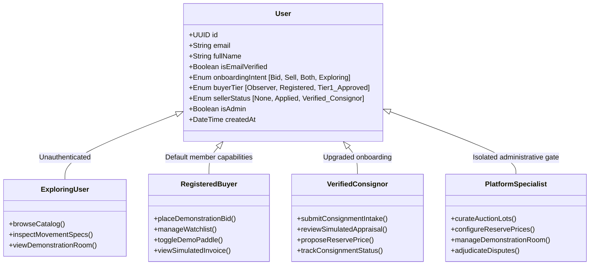
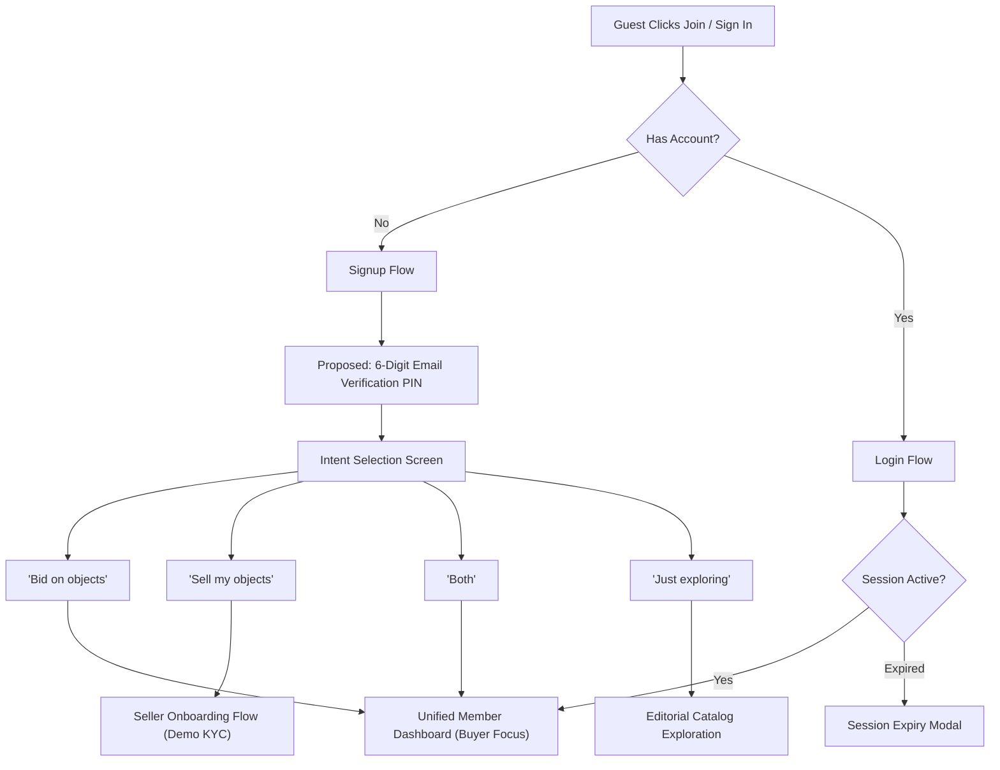
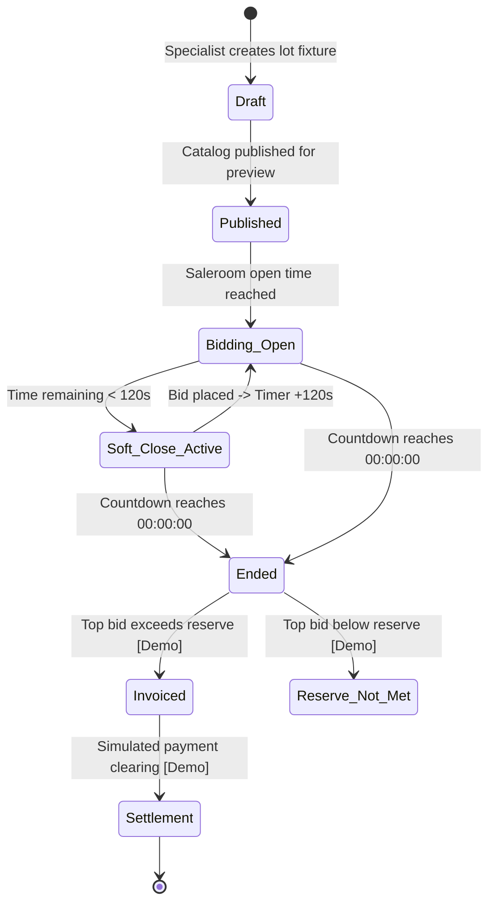
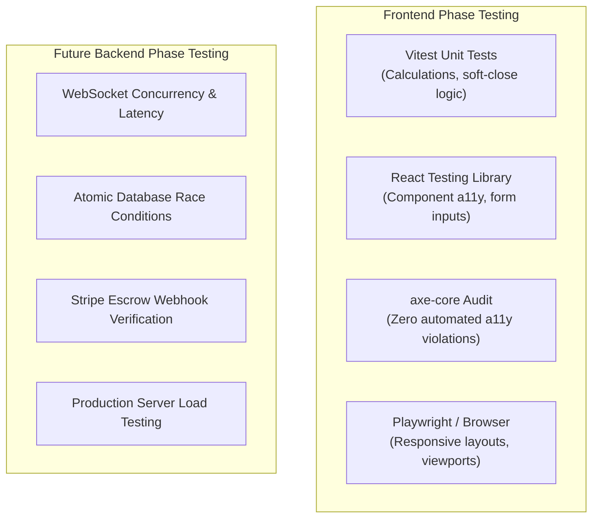

# ChronoBid Vault — Phase 1: Requirements & Design Specification (v2.2)

> **Document Status:** FORMALLY APPROVED PHASE 1 BASELINE (Signed off by Project Owner on 2026-10-17).  
> **Governance Notice:** The Project Owner formally approved the Phase 1 Requirements & Design Specification (v2.2) on 2026-10-17 as the project baseline. Phase 2 is NOT authorised. No website implementation, Next.js scaffolding, component generation, or dependency installation may begin until separate, explicit written project owner authorisation for Phase 2 is granted.  
> **Target System:** ChronoBid Vault (Curated Fine Horology & Rare Timepiece Auction System)  
> **Document Version:** 2.2 (Approved Baseline — October 2026)  
> **Preserved Archives:**  
> - [phase1_requirements_and_design_specification_v1.md](file:///C:/Users/kbjee/.gemini/antigravity/brain/a1cb3096-bf53-49f1-84e2-572bb49a89f3/phase1_requirements_and_design_specification_v1.md) (Original v1.0 Archive)  
> - [phase1_requirements_and_design_specification_v2.md](file:///C:/Users/kbjee/.gemini/antigravity/brain/a1cb3096-bf53-49f1-84e2-572bb49a89f3/phase1_requirements_and_design_specification_v2.md) (v2.1 Archive)  
> - [phase1_requirements_and_design_specification.md](file:///c:/Users/kbjee/OneDrive/Desktop/omniroute/auction%20system/phase1_requirements_and_design_specification.md) (Active Working Specification v2.2)

---

## Change Log: Version 2.1 &rarr; Version 2.2

| Section | Nature of Revision | Rationale & Approved User Directive |
| :--- | :--- | :--- |
| **Owner Confirmed Decisions (Sections 2.1, 2.3, 4.2, 5.6, 12.3, 14.1, 14.3)** | Recorded project owner's confirmed decisions for ADR-012 (120s clock reset with 10-extension cap, <120s boundary rule, post-cap pre-deadline bid acceptance without reset, and deadline rejection), ADR-013 (roadmap deferral of 5 features), ADR-019 (5-tier increment schedule and Option B jump-bid ladder for prototype simulation only), ADR-020 (auth parameters as unapproved draft assumptions with arbitrary test PIN fixture), and ADR-021 (7 display currencies with fixed demo multipliers rounded to documented precision derived from verified 16 Oct 2026 ECB rates for prototype display only, executing directly against rounded values). | Reconciles owner-approved prototype simulation/display rules while strictly preserving the unapproved status of auth assumptions and the Phase 2 implementation block. |
| **How It Works (Section 6.1, Step 8)** | Explicitly designated Escrow Custody and Insured Transit as **proposed future services**, not currently available services | Truth in advertising; ensures public prototype never claims operational services exist prior to real launch. |
| **Seller Journey (Section 2.3 & 4.3)** | Reclassified the 48-hour appraisal ticket as **simulated demo feedback**, not a real appraisal commitment | Eliminates false SLA promises; clarifies that prototype feedback is simulated for demonstration only. |
| **Authentication & Onboarding (Section 5)** | Substantially expanded requirements for signup, login, logout, password visibility, forgot password, password reset, email verification, validation errors, session expiry, and seller onboarding | Documents exhaustive functional specifications, expected behaviors, and measurable acceptance criteria for each flow. |
| **Demo vs. Production Boundaries (Section 10.2)** | Created explicit boundary matrix across 8 core domain dimensions (Listings, Prices, Bids, Seller Verification, Provenance, Appraisal, Payments, Escrow) | Completely eliminates ambiguity between client-side demonstration behavior and production operational systems. |
| **Provisional Watch Listings (Section 2.3 & 8.3)** | Re-confirmed that all 6 watch listings remain strictly provisional pending exact reference, detail, and image rights verification | Prevents unverified horological claims or copyright infringements on sample models. |
| **Governance Checklist (Section 14)** | Added comprehensive 4-part governance checklist covering confirmed requirements, unresolved decisions, acceptance criteria, and outstanding user approvals | Provides immediate visibility into project readiness without guessing. |

---

## 1. Product Mission & Scope

### 1.1 Mission Statement
ChronoBid Vault is an artisanal, highly curated digital auction house dedicated to rare, vintage, and historically significant horological timepieces. The system is designed to provide the tactile dignity, bespoke curation, and provenance-first presentation of premier European salerooms while leveraging modern, accessible web technologies.

### 1.2 Core Scope & Boundaries
- **In-Scope (Frontend Demonstration Prototype):**
  - High-fidelity editorial-parallax presentation built with Next.js App Router, React, TypeScript, and Tailwind CSS.
  - Interactive demonstration catalog with faceted filters (Brand, Era, Complication, Case Material).
  - Demonstration auction room showing real-time countdowns, simulated counter-bidding, and soft-close mechanics.
  - Multi-step consignment intake workflow for collectors wishing to consign timepieces.
  - Unified member portal supporting saved watchlists, demo paddles, and consignment tracking.
  - Transparent sandbox simulation disclaimers throughout all interactive components.
- **Out-of-Scope (Future Backend & Operational Production):**
  - Real financial payment processing, escrow settlement, and merchant payouts.
  - Authoritative multi-region distributed websocket auction clusters.
  - Production legal identity verification (real KYC/AML checks).
  - Physical custody, armored courier logistics, and physical vault storage.

---

## 2. Confirmed Requirements, Assumptions & Unresolved Decisions

## 2. Decision Registry: Confirmed, Provisional & Unresolved

Every architectural, design, account, and auction decision is strictly classified under one of three governance states: **Approved** (locked by project owner), **Provisional** (working baseline pending verification), or **Unresolved** (pending explicit project owner review and approval).

### 2.1 Approved Decisions (Locked Baseline)
1. **Project Scope & Identity:** ChronoBid Vault — curated fine horology & rare timepiece auction platform.
2. **Visual Direction:** Editorial-parallax, premium-light, bespoke monograph publication aesthetic.
3. **Typography System:** `Instrument Serif` (Display), `Manrope` (Body/UI), `IBM Plex Mono` (Technical/Numbers).
4. **Color Tokens:** Warm Paper (`#F4F0E8`), Deep Forest (`#182720`), Acid Lime (`#D7E65A`), Stone (`#D8D0C2`).
5. **Approved Frontend Stack:** Next.js App Router, React, TypeScript, Tailwind CSS (Approved for future implementation).
6. **Homepage Section Sequence:** Approved 11-section order (Announcement &rarr; Header &rarr; Hero &rarr; Intro &rarr; Collection &rarr; Interlude &rarr; Saleroom &rarr; How It Works &rarr; Trust &rarr; Invitation &rarr; Footer).
7. **Account Hierarchy:** Unified account model supporting buyer and seller capabilities in one profile; admin privileges separated.
8. **Icon Library:** Exclusively `lucide-react` with 100% accessible names via `aria-label` or `.sr-only`.
9. **Image Governance Policy:** Mandatory `IMAGE_MANIFEST.md` schema, matching subject references, zero invented URLs.
10. **Universal Demo Data Tagging:** Mandatory visible `[DEMO DATA]` and `[SANDBOX SIMULATION]` indicators on all fictional fixtures.
11. **Future Service Classification:** Escrow custody and insured courier transit are classified strictly as proposed future capabilities.
12. **Simulated Appraisal Feedback:** The 48-hour appraisal ticket is classified strictly as simulated demo feedback, not a legal SLA.
13. **Currency Conversion Mechanics:** Approved for prototype display only (not production authorization): supports 7 display currencies (USD base, EUR, CHF, GBP, JPY, HKD, SGD) using fixed demo multipliers rounded to documented precision (EUR 0.8887, GBP 0.7499, CHF 0.8240, JPY 158.02, HKD 7.8482, SGD 1.2792) derived from verified European Central Bank reference rates of 16 October 2026. Prototype conversions execute directly against these rounded multipliers (e.g., $100,000 × 0.8887 = €88,870) with `Intl.NumberFormat` rounding and `[CONVERSION UNAVAILABLE]` fallback.
14. **Proxy Bidding Mechanics:** Prototype client-side engine automatically steps bids up to the user's confidential ceiling against simulated bots.
15. **Mobile Sticky Bidding Bar:** Approved for viewports &lt;768px when scrolled past Section 7.
16. **Image Fallback Handling:** Approved fallback to an accessible monograph card (`#EDE7DC`) upon loading failure.
17. **Strict Implementation Gate:** No-coding rule strictly enforced; Phase 2 remains unauthorized.

### 2.2 Provisional Decisions (Working Baseline Pending Verification)
1. **Debut Timepiece Catalog:** The 6 initial watch references remain strictly **provisional** until exact references, archival provenance records, and image usage rights are cleared:
   - *1968 Patek Philippe Calatrava Ref. 3520D (Yellow Gold)* — Provisional
   - *1972 Audemars Piguet Royal Oak Ref. 5402ST "A-Series" (Jumbo)* — Provisional
   - *1965 Rolex Daytona Cosmograph Ref. 6239 "Paul Newman"* — Provisional
   - *1957 Omega Speedmaster Ref. CK 2915-1 "Broad Arrow"* — Provisional
   - *1928 Cartier Tank Cintrée Dual-Time (Platinum)* — Provisional
   - *1999 A. Lange & Söhne Datograph Ref. 403.035 (Platinum)* — Provisional

### 2.3 Selected Approaches & Draft Technical Assumptions (Owner-Selected Decisions)
1. **Auction Anti-Sniping (ADR-012):** Approved decision for prototype simulation is a 120-second clock-reset model with an extension cap. Pre-deadline bids are evaluated under normal bid validation regardless of whether the extension cap has been reached. A valid bid submitted with strictly less than 120 seconds remaining (00:01:59 or less) resets the lot countdown clock to exactly 120 seconds (00:02:00) provided fewer than 10 extensions have been consumed. A bid submitted at exactly 00:02:00 is accepted under normal validation, but does not trigger a reset or consume an extension. A hard cap of 10 extensions is enforced per lot (+20 minutes max overrun). Post-cap behavior: valid bids submitted before the deadline may still be accepted under normal validation, but no further soft-close reset is eligible after 10 extensions; the clock never resets again and the lot closes definitively at 00:00:00. Bids submitted at or after 00:00:00 are rejected. *(Status: Approved Decision — Prototype Simulation)*
2. **Optional Features Roadmap Deferral (ADR-013):** Selected approach formally defers five features to the future product roadmap and strictly excludes them from the Phase 1 core homepage: (1) World clocks, (2) Live hammer price ticker, (3) Historic sales archive, (4) Horological journal, and (5) Consignment valuation calculator. The agreed 11-section homepage sequence is strictly preserved. *(Status: Selected Approach — Deferred to Future Roadmap)*
3. **Bid Increment Schedule (ADR-019):** Approved decision establishes a 5-tier schedule (<$10k: +$250; $10k–$49,999: +$1,000; $50k–$99,999: +$2,500; $100k–$249,999: +$5,000; $250k+: +$10,000) strictly for prototype simulation (not production authorization). Custom jump-bids follow Option B (Destination-Tier Ladder Model), requiring any custom bid crossing into a higher tier to land on an exact multiple of the destination tier's increment anchored at its lower boundary. *(Status: Approved Decision — Prototype Simulation Only)*
4. **Authentication Parameters (ADR-020):** Four technical parameters are recorded strictly as **unapproved draft assumptions pending security review**: 6-digit email verification PIN, 15-minute token expiry, 10-character password rule, and 5 failed attempts per 15 minutes throttling threshold. These are not marked as approved or production-ready and require security review before implementation. Prototype test PIN (123456) is classified strictly as an arbitrary testing convenience fixture for demonstration. *(Status: Draft Assumptions — Unapproved, Pending Security Review)*

### 2.4 Outstanding Governance Approvals Required Before Phase 2
1. **Phase 1 Formal Sign-Off:** Formally approved by Project Owner on 2026-10-17 as project baseline v2.2. *(STATUS: APPROVED)*
2. **Phase 2 Authorization:** Explicit, separate written instruction from project owner authorising Phase 2 implementation. *(STATUS: PHASE 2 NOT AUTHORISED — IMPLEMENTATION BLOCKED)*


---

## 3. User Roles & Permissions

The platform enforces a single unified account structure for all participants, with administrative privileges provisioned separately:



### 3.1 Role Definitions & Permission Matrix

| Capability | Exploring User (Guest) | Registered Member (Buyer) | Verified Consignor (Seller) | Platform Administrator |
| :--- | :---: | :---: | :---: | :---: |
| **Browse Public Homepage & Catalog** | Yes | Yes | Yes | Yes |
| **Filter by Brand, Era, Calibre** | Yes | Yes | Yes | Yes |
| **View Demonstration Auction Room** | Read-Only | Interactive (Demo Paddle) | Interactive (Demo Paddle) | Room Controller |
| **Save Items to Watchlist** | No (Auth modal) | Yes | Yes | Yes |
| **Place Simulated Bids** | No (Auth modal) | Yes | Yes | No (Neutrality Rule) |
| **Submit Consignment Intake** | No (Auth modal) | Yes (Triggers Onboarding) | Yes | Oversees Queue |
| **Approve Consignments & Set Reserves** | No | No | No | Yes |
| **Access Admin Configuration** | No | No | No | Yes |

*Note: The post-signup onboarding intent selection ("Bid on objects", "Sell my objects", "Both", "Just exploring") is a changeable user preference and routing path. It does NOT automatically grant privileged access or bypass verification gates.*

---

## 4. User Journeys & Acceptance Criteria

### 4.1 Guest Browsing Journey
- **User Action:** Arrives at homepage, reads editorial narrative, inspects featured collection, filters lots by era or brand, opens a lot detail view.
- **Acceptance Criteria:**
  - 100% of public views render without authentication blockers.
  - Interactive controls attempting state persistence (e.g., "Add to Watchlist", "Place Bid", "Consign a Watch") open the authentication drawer with context preserved.
  - All mock lots, countdowns, and prices prominently display `[DEMO DATA]` tags.

### 4.2 Buyer Journey (Simulated Bidding)
- **User Action:** Enrolls in upcoming demo auction, enters featured live room, reviews current ask and next minimum increment, places simulated bid, monitors soft-close countdown, receives outbid alerts.
- **Acceptance Criteria:**
  - Real-time bid input restricts bids below the calculated minimum increment based on the approved 5-tier prototype schedule (<$10k: +$250, $10k–$49,999: +$1,000, $50k–$99,999: +$2,500, $100k–$249,999: +$5,000, $250k+: +$10,000; prototype simulation only) and validates custom jump-bids against the Option B Destination-Tier Ladder Model.
  - Placement of a valid bid updates current bid, log history, and paddle reference immediately.
  - Simulates competing bids realistically without blocking browser thread.
  - Submitting a valid bid before the deadline is evaluated under normal validation rules regardless of extension count. Submitting with <120s remaining (00:01:59 or less) resets the countdown clock to exactly 120 seconds (00:02:00) and increments the extension counter, provided fewer than 10 extensions have been consumed. Bids placed at exactly 00:02:00 are accepted under normal validation without triggering a reset or consuming an extension. After 10 extensions, valid pre-deadline bids continue to be accepted under normal validation, but no further soft-close reset is eligible. Bids submitted at or after 00:00:00 are rejected.
  - Outbid notifications display via accessible toast / aria-live polite announcements.

### 4.3 Consignor (Seller) Journey
- **User Action:** Navigates to consignment intake form, enters watch reference, serial number, production era, box/papers status, and attaches reference imagery.
- **Acceptance Criteria:**
  - Multi-step form validates inputs (year format, reference string, file upload mock).
  - Explicit disclaimer: *"Prototype Submission: Do not upload confidential serial numbers or real identity documents."*
  - **Simulated Demo Feedback:** Submission generates a tracking ticket with simulated status: `Under Specialist Review (Simulated Demo Feedback — Not a Real Appraisal Commitment)`. The 48-hour appraisal timeline is explicitly described as demonstration feedback, not a legally binding SLA.

### 4.4 Combined Buyer/Seller Journey
- **User Action:** Collector switches between bidding on upcoming lots and monitoring their consigned timepiece valuations from a single unified portal.
- **Acceptance Criteria:**
  - Single login session maintains unified state.
  - Account navigation offers clear segmented tabs: "My Bids & Watchlist" and "Consigned Lots & Valuations".
  - Profile state transitions smoothly between buyer actions and consignor tools without re-authenticating.

### 4.5 Exploring-User Journey
- **User Action:** Visitor selects "Just exploring" during onboarding.
- **Acceptance Criteria:**
  - Lands on curated editorial view without aggressive sales prompts.
  - Preserves exploration history in local state (recently viewed references).
  - Upgrading to bidding or selling is one click away via header prompt.

---

## 5. Complete Account & Authentication Requirements

> [!NOTE]
> **Authentication Parameters Status (Unapproved Draft Assumptions):** The technical thresholds specified throughout Section 5 (6-digit email PIN, 15-minute token expiry, 10-character password rule, and 5 failed attempts per 15 minutes throttling limit) are maintained strictly as **unapproved draft assumptions pending security review**. They are NOT marked as approved or production-ready and require formal security review before implementation.



### 5.1 Signup Journey & Acceptance Criteria
- **Expected Behaviour:**
  1. User enters Email, Full Name, Password, and Confirm Password.
  2. Live inline validation checks RFC 5322 email syntax and password strength.
  3. Clicking "Create Account" disables the button, displays a loading spinner with text *"Creating secure member profile..."*, and transitions to the simulated Email Verification screen.
- **Validation Rules & Error Handling:**
  - Email: Required, must match `^[^\s@]+@[^\s@]+\.[^\s@]+$`. Error: *"Please enter a valid email address."*
  - Password: Required, minimum 10 characters, at least 1 uppercase, 1 lowercase, 1 digit. Error: *"Password must be at least 10 characters and contain uppercase, lowercase, and numbers."*
  - Password Match: Confirm password must strictly match password. Error: *"Passwords do not match."*
  - Duplicate Account: If email already exists, display error banner: *"An account with this email already exists. Please sign in."*
- **Acceptance Criteria:**
  - [ ] All inputs have explicit `<label>` tags with `htmlFor` bindings.
  - [ ] Inline errors announce via `aria-describedby` and set `aria-invalid="true"`.
  - [ ] Submitting invalid forms focuses the first erroneous field.

### 5.2 Login Journey & Acceptance Criteria
- **Expected Behaviour:**
  1. User enters Email and Password with optional "Remember Me" checkbox.
  2. Clicking "Sign In" verifies credentials against local mock state.
  3. On success, issues a mock session token, updates header to show assigned paddle number, and restores previous browsing context.
- **Error Handling:**
  - Invalid Credentials: Display generic alert *"Invalid email or password. Please verify your credentials and try again."* (Generic wording prevents account enumeration).
  - Throttling: If &ge;5 failed attempts occur within 15 minutes, display *"Too many failed login attempts. Please wait 15 minutes or reset your password."*
- **Acceptance Criteria:**
  - [ ] Successful login redirects to the page where the user initiated the auth action.
  - [ ] Screen readers announce login success via `aria-live="polite"`.

### 5.3 Logout & Session Expiry
- **Expected Behaviour:**
  - User clicks "Sign Out" in account menu.
  - System invalidates mock session token, clears active user state from memory, and redirects to homepage.
  - Displays non-blocking notification toast: *"You have been signed out of ChronoBid Vault."*
- **Session Expiry Handling:**
  - Inactivity timeout (simulated at 30 minutes in demo).
  - When session expires, an accessible modal appears: *"Your session has timed out due to inactivity. Please sign in to resume your active bids."*
  - Current form state or active lot draft is preserved in local storage so no collector input is lost upon re-authenticating.
- **Acceptance Criteria:**
  - [ ] Logging out immediately resets UI paddle indicators to guest state.
  - [ ] Session expiry modal traps keyboard focus and provides a direct re-login trigger.

### 5.4 Password Visibility Toggle
- **Expected Behaviour:**
  - Password inputs feature an integrated Lucide icon button (`Eye` when obscured, `EyeOff` when revealed).
  - Clicking toggle switches input `type="password"` &harr; `type="text"` instantaneously without losing cursor position or focus.
- **Acceptance Criteria:**
  - [ ] Icon button has dynamic `aria-label`: `"Show password"` when obscured, `"Hide password"` when visible.
  - [ ] Keyboard navigable via `Tab` and triggers on `Enter` / `Space`.

### 5.5 Forgot Password & Password Reset Flow
- **Expected Behaviour:**
  1. User clicks "Forgot Password?" link on login form.
  2. Enters registered email address and clicks "Send Reset Link".
  3. System displays confirmation screen: *"If an account exists for this email, you will receive password reset instructions shortly."* (Enumeration-resistant).
  4. Reset link contains a simulated 15-minute token.
  5. Clicking link opens Reset Password screen: inputs for New Password and Confirm New Password with strength validation.
  6. Submitting updates password, invalidates all existing sessions, and redirects to Login with success banner.
- **Acceptance Criteria:**
  - [ ] Token expiration is validated on page load; expired tokens render an error with a "Request New Link" button.
  - [ ] Form adheres to identical password complexity rules as initial signup.

### 5.6 Email Verification Flow (Proposed Technical Decision)
- **Expected Behaviour:**
  1. Displays 6 individual digit input boxes with automatic focus advancement upon digit entry.
  2. Paste handling: Pasting a 6-digit code auto-populates all 6 inputs.
  3. Resend Code button accompanied by a 60-second countdown timer (`"Resend code in 48s"`).
  4. Entering correct PIN (`123456` as an arbitrary prototype demonstration test fixture; unapproved draft assumption) activates account and immediately routes to Intent Selection.
- **Acceptance Criteria:**
  - [ ] Backspace on an empty box automatically moves focus to the preceding input.
  - [ ] Screen readers announce *"Verification code accepted. Proceeding to intent selection."*

### 5.7 Post-Signup Intent Selection Screen
- **Expected Behaviour:**
  - User presented with 4 distinct interactive cards:
    1. **"Bid on objects"**: Focuses experience on active salerooms, watchlists, and paddle allocation.
    2. **"Sell my objects"**: Routes directly into the Consignment Intake flow.
    3. **"Both"**: Configures unified account view with dual navigation tabs.
    4. **"Just exploring"**: Returns user to editorial catalog without conversion pressure.
  - *Governance Rule:* Intent selection is a changeable UI routing preference; it does not grant administrative privileges.
- **Acceptance Criteria:**
  - [ ] User can change this preference anytime in `/account/settings`.

### 5.8 Seller Onboarding Workflow (Demo KYC)
- **Expected Behaviour:**
  1. Step 1: Legal Identity & Physical Address (Mock inputs: Full Name, Address, Country).
  2. Step 2: Collector / Consignor Background (Years collecting, primary horological focus).
  3. Step 3: Payout Settlement Method Mock (Bank Name, IBAN / SWIFT masked).
  4. Prominent Warning: `[DEMO PROTOTYPE ONLY: DO NOT ENTER REAL GOVERNMENT IDENTIFICATION NUMBERS OR BANK ACCOUNTS.]`
  5. Submission records consignment privileges in mock user state.
- **Acceptance Criteria:**
  - [ ] Prototype strictly validates input formats without transmitting real PII.
  - [ ] Unlocks the "Consign a Timepiece" submission portal in the unified dashboard.

---

## 6. Homepage Architecture (Approved 11-Section Sequence)

The ChronoBid Vault homepage is structured strictly according to the approved 11-section sequence. It is art-directed as a **prestigious horological monograph**, balancing editorial white space, restrained luxury typography, and tactile interaction.

```
+-----------------------------------------------------------------------------------+
| 1. Announcement Strip                                                            |
+-----------------------------------------------------------------------------------+
| 2. Header and Navigation                                                          |
+-----------------------------------------------------------------------------------+
| 3. Editorial Hero: "Objects worth waiting for."                                  |
+-----------------------------------------------------------------------------------+
| 4. Editorial Introduction                                                         |
+-----------------------------------------------------------------------------------+
| 5. Featured Collection (with working category filters)                            |
+-----------------------------------------------------------------------------------+
| 6. Full-Width Editorial Interlude                                                 |
+-----------------------------------------------------------------------------------+
| 7. Featured Auction Room                                                          |
+-----------------------------------------------------------------------------------+
| 8. How It Works (Clarified: Escrow & Transit are Proposed Future Services)        |
+-----------------------------------------------------------------------------------+
| 9. Trust and Transparency                                                         |
+-----------------------------------------------------------------------------------+
| 10. Final Invitation                                                              |
+-----------------------------------------------------------------------------------+
| 11. Footer                                                                        |
+-----------------------------------------------------------------------------------+
```

### 6.1 Section-by-Section Specification

#### Section 1: Announcement Strip
- **Position:** Topmost viewport element, 0px margin.
- **Content Hierarchy:** Eyebrow alert indicating the current curated saleroom drop or demo status.
  - Text: `[SANDBOX SIMULATION] Curated Horological Drop 04: Rare Mid-Century Chronographs — Preview Open.`
- **Primary Action:** Link to upcoming drop preview.
- **Secondary Action:** Dismiss notification or view demo disclosure.
- **Responsive Behaviour:** Height 36px desktop, 42px mobile (wrapped text). Sticky or static (unpins on scroll).
- **Interactions:** Subtle hover color shift on link (`opacity: 0.85` over 160ms).

#### Section 2: Header & Navigation
- **Position:** Below announcement strip; sticky on scroll with background glass blur.
- **Content Hierarchy:**
  - Left: Brand Wordmark (`CHRONOBID VAULT` in `Instrument Serif` / `IBM Plex Mono` subtitle).
  - Center: Primary editorial links (`Catalog`, `How It Works`, `Transparency`).
  - Right: Currency Selector (`USD $`), Watchlist Trigger (Lucide `Bookmark`), Account Button (`Sign In` / `Paddle #`).
- **Primary Action:** `Sign In` / `Register`.
- **Secondary Action:** Open navigation search drawer or filter catalog.
- **Responsive Behaviour:** Desktop shows full horizontal links; Tablet (&lt;1024px) condenses currency; Mobile (&lt;768px) collapses into an accessible slide-over sheet.
- **Interactions:** Keyboard navigable; focus ring (2px solid `#182720`); backdrop morphs to `#F4F0E8` with 8px blur on scroll past 40px.

#### Section 3: Editorial Hero ("Objects worth waiting for.")
- **Position:** Above-the-fold centerpiece.
- **Content Hierarchy:**
  - Display Headline in `Instrument Serif`: *"Objects worth waiting for."*
  - Editorial Narrative in `Manrope`: 2-sentence manifesto on mechanical purity, provenance, and patience.
  - Featured Marquee Timepiece Visual: Asymmetric layout showcasing a provisional museum-grade reference (e.g. 1968 Patek Philippe Calatrava Ref. 3520D).
  - Micro-data Strip in `IBM Plex Mono`: Lot number, Calibre spec, Estimated hammer, Status (`[PROVISIONAL DEMO SPECIMEN]`).
- **Primary Action:** `Explore Current Lots` (tactile button with Acid Lime hover).
- **Secondary Action:** `Read the Provenance Dossier`.
- **Responsive Behaviour:**
  - Desktop (1440px): 12-column grid; 7 cols typography & data, 5 cols portrait photography.
  - Mobile (390px): Single stacked column; headline wraps cleanly; image aspect ratio 4:5.
- **Interactions:** Initial text reveal (450–650ms), image slow fade-in (900–1200ms). Subtle scroll parallax (disabled under `prefers-reduced-motion`).

#### Section 4: Editorial Introduction
- **Position:** Below Hero, framed by generous vertical white space (96–120px padding).
- **Content Hierarchy:**
  - Small Roman numeral or mono index: `01 / THE PHILOSOPHY`.
  - Prominent Serif Statement (32–44px): *"In an era of disposable volume, we curate timepieces with indelible provenance and mechanical integrity."*
  - Supporting two-column essay copy (16–18px `Manrope`) explaining physical inspection standards and consignment ethics.
- **Primary Action:** `Learn About Our Standards` (text link with animated underline).
- **Secondary Action:** None (pure editorial immersion).
- **Responsive Behaviour:** 2 columns on desktop (&gt;1024px); collapses to single column on mobile.

#### Section 5: Featured Collection (with Working Category Filters)
- **Position:** Mid-page catalog showcase.
- **Content Hierarchy:**
  - Section Title: *"The Curated Vault Selection"* (52–68px `Instrument Serif`).
  - Filter Tabs in `Manrope` / `IBM Plex Mono`: `All Specimens`, `Chronographs`, `Dress & Ultra-Thin`, `Historic Divers`, `Complications`.
  - Grid: 3-column asymmetric editorial cards. Each card displays:
    - High-res timepiece photo (4:5 ratio) with hover zoom.
    - Reference & Manufacturer in `Manrope` bold.
    - Year & Calibre in `IBM Plex Mono`.
    - Current Ask / Estimate with explicit `[DEMO DATA]` tag.
    - Quick-inspect button.
- **Primary Action:** Filter tabs (instant reactive client-side filter transition 180–260ms).
- **Secondary Action:** Click card to open full Lot Detail Room.
- **Responsive Behaviour:** 3 columns at 1440px/1280px; 2 columns at 1024px/768px; 1 column with horizontal scroll option at 390px/360px.
- **Interactions:** Image hover scale 1.025 over 400ms. Empty state handles zero results gracefully with a reset action.

#### Section 6: Full-Width Editorial Interlude
- **Position:** Visual breather between collection and live room.
- **Content Hierarchy:**
  - Edge-to-edge container in Deep Forest (`#182720`) with Warm Paper typography (`#F4F0E8`).
  - Macro mechanical movement imagery (escapement balance wheel / Geneva stripes).
  - Pull Quote in italic `Instrument Serif` (40–56px): *"Every tick is an unbroken mechanical lineage dating back two centuries."*
- **Primary Action:** None (visual atmosphere).
- **Secondary Action:** None.
- **Responsive Behaviour:** Full bleed width; height constrained to 480px on desktop, 320px on mobile.

#### Section 7: Featured Auction Room
- **Position:** Live auction demonstration block.
- **Content Hierarchy:**
  - Section Header: *"Live Saleroom Demonstration"* with pulsating Acid Lime indicator (`● ROOM OPEN`).
  - Marquee Live Lot Container:
    - Dual split pane: Left pane displays live studio angles; right pane displays the active bidding room console.
    - Real-Time Countdown in `IBM Plex Mono` (e.g. `00:04:32`).
    - Current Highest Ask: `$42,500 USD` `[DEMO]`.
    - Live Bid Log showing anonymous paddles (`Paddle #4102`, `Paddle #1890`).
    - Interactive Bid Button: `Bid $43,000 [DEMO]`.
- **Primary Action:** Click to place demonstration bid.
- **Secondary Action:** Toggle sound effects / Open soft-close explanation modal.
- **Responsive Behaviour:** Split pane on desktop (&gt;1024px); stacked vertical panes on mobile with sticky bottom bid bar.
- **Interactions:** Placing bid triggers optimistic update, counter-bid bot after 3–6s, and soft-close timer extension if &lt;120s remaining.

#### Section 8: How It Works (Corrected: Proposed Future Services)
- **Position:** Procedural guide section.
- **Content Hierarchy:**
  - Heading: *"The Mechanics of Acquisition & Consignment"*.
  - 4 Sequential Numbered Architectural Steps:
    1. *Curated Vetting:* Specialist physical intake and multi-point audit.
    2. *Verified Bidding:* Transparent registration, transparent paddles, soft-close anti-sniping.
    3. *Escrow Custody (Proposed Future Service):* Third-party legal escrow holding funds securely until physical inspection passes. `[PROPOSED FUTURE SERVICE — NOT CURRENTLY AVAILABLE]`.
    4. *Insured Transit (Proposed Future Service):* Armored courier handover to the collector's door under comprehensive transit policy. `[PROPOSED FUTURE SERVICE — NOT CURRENTLY AVAILABLE]`.
- **Primary Action:** `View Complete Buyer & Consignor Guide`.
- **Secondary Action:** None.
- **Responsive Behaviour:** 4 horizontal columns on desktop; 2x2 grid on tablet; vertical step accordion on mobile.

#### Section 9: Trust & Transparency
- **Position:** Service standards and compliance declaration.
- **Content Hierarchy:**
  - Section Title: *"The Transparency Commitment"*.
  - 3 Core Truthfulness Pillars:
    - *Provable Provenance:* Archival records and serial verification.
    - *Independent Condition Audit:* Timegrapher accuracy and mechanical diagnosis.
    - *Sandbox Honesty:* Persistent declaration that current listings represent demonstration models, not real stock.
- **Primary Action:** `Inspect Sample Condition Dossier`.
- **Secondary Action:** `Read Dispute & Custody Policies`.
- **Responsive Behaviour:** 3 balanced columns; stacked on mobile.

#### Section 10: Final Invitation
- **Position:** Pre-footer conversion callout.
- **Content Hierarchy:**
  - Serif Headline: *"Begin Your Collection or Entrust a Masterpiece."*
  - Dual Editorial Cards:
    - Card A (Buyers): *"Register for Upcoming Drops"* &rarr; Primary Button.
    - Card B (Consignors): *"Request a Private Valuation"* &rarr; Secondary Button with Stone border.
- **Primary Action:** Register to Bid (`#D7E65A` Acid Lime CTA).
- **Secondary Action:** Consign a Watch (`#182720` Outline CTA).
- **Responsive Behaviour:** 2 columns on desktop; 2 stacked cards on mobile.

#### Section 11: Footer
- **Position:** Bottommost page boundary.
- **Content Hierarchy:**
  - Top: Horological wordmark and mission summary.
  - Middle Columns: Navigation (Catalog, Salerooms, Archives, About, Legal).
  - Bottom Bar:
    - Mandatory Persistent Notice: `[CHRONOBID VAULT SANDBOX — PROTOTYPE ONLY. NO FINANCIAL TRANSACTIONS ARE CONDUCTED.]`
    - Currency selector, Copyright &copy; 2026 ChronoBid Vault, WCAG 2.2 AA Accessibility statement link.
- **Primary Action:** Navigation links.
- **Secondary Action:** Change currency / Read privacy statement.
- **Responsive Behaviour:** Multi-column layout collapsing into nested accordions on mobile.

---

### 6.2 Optional Features Roadmap Deferral (Owner-Selected Decision — ADR-013)
*In accordance with the project owner's selected decision (ADR-013), the following five features are formally deferred to the future product roadmap and are strictly excluded from the Phase 1 core homepage scope. The agreed 11-section homepage sequence is strictly preserved without these additions:*
1. **World clocks** (Global horological masthead clocks: Geneva, London, NY, Tokyo).
2. **Live hammer price ticker** (Real-time realized lot price ticker strip).
3. **Historic sales archive** (Historical auction realization ledger & hammer price charts).
4. **Horological journal** (Long-form calibre editorial dispatches & monographs).
5. **Consignment valuation calculator** (Interactive automated appraisal estimator).

---

## 7. Typography, Layout Tokens & Motion Parameters

### 7.1 Font System & Sizing Scale

```
Instrument Serif (Display Headings, Editorial Accents)
Manrope (Interface UI, Body Text, Buttons, Form Fields)
IBM Plex Mono (Technical Data, Lot References, Timers, Prices)
```

#### Approved Desktop Typography Scale (&ge;1024px)
- **Hero Display:** `88px – 112px` (Line height: `1.05`, Letter spacing: `-0.02em`)
- **Main Section Heading:** `52px – 68px` (Line height: `1.1`, Letter spacing: `-0.015em`)
- **Collection / Subsection Heading:** `32px – 44px` (Line height: `1.2`)
- **Auction Item / Lot Title:** `24px – 30px` (Line height: `1.3`)
- **Large Auction Price / Hammer Value:** `32px – 40px` (`IBM Plex Mono`, font-weight: `600`)
- **Body Copy:** `16px – 18px` (`Manrope`, line-height: `1.6`, font-weight: `400`)
- **Navigation Links:** `13px – 15px` (`Manrope`, font-weight: `500`, letter-spacing: `0.02em`)
- **Button Labels:** `14px – 15px` (`Manrope`, font-weight: `600`, letter-spacing: `0.03em`)
- **Technical Metadata / Badges:** `10px – 12px` (`IBM Plex Mono`, uppercase, letter-spacing: `0.08em`)

#### Approved Mobile Typography Scale (&lt;768px)
- **Hero Display:** `46px – 58px` (Line height: `1.1`)
- **Main Section Heading:** `34px – 42px` (Line height: `1.15`)
- **Collection Heading:** `27px – 34px` (Line height: `1.25`)
- **Auction Item Title:** `22px – 27px` (Line height: `1.3`)
- **Large Auction Price:** `28px – 34px` (`IBM Plex Mono`)
- **Body Copy:** At least `16px` (Strictly prevents iOS Safari automatic form zoom).

---

### 7.2 Responsive Breakpoints & Viewport Grid

| Breakpoint Name | Viewport Width | Grid Columns | Content Max-Width | Horizontal Margin / Padding |
| :--- | :---: | :---: | :---: | :---: |
| **Wide Desktop** | `1440px+` | 12 | `1360px` | `48px` |
| **Standard Desktop** | `1280px – 1439px` | 12 | `1200px` | `40px` |
| **Small Desktop / Tablet Landscape** | `1024px – 1279px` | 12 | `960px` | `32px` |
| **Tablet Portrait** | `768px – 1023px` | 8 | `720px` | `24px` |
| **Mobile Large** | `390px – 767px` | 4 | `100%` | `16px` |
| **Mobile Compact** | `360px – 389px` | 4 | `100%` | `12px` |

---

### 7.3 Spacing, Aspect Ratios & State Tokens
- **Spacing Scale:** Modular 4px base (`4px`, `8px`, `12px`, `16px`, `24px`, `32px`, `48px`, `64px`, `96px`, `128px`).
- **Image Aspect Ratios:**
  - Lot Cards / Studio Macro: `4:5` (Vertical portrait).
  - Editorial Hero / Interlude: `16:9` or `21:9` (Cinematic wide).
  - Square Thumbnails: `1:1`.
- **Interactive State Tokens:**
  - **Focus States:** Mandatory `2px solid #182720` with `2px` offset on all keyboard-focused interactive elements.
  - **Button States:**
    - Default: Solid `#182720` with `#F4F0E8` text, or Acid Lime `#D7E65A` with `#182720` text.
    - Hover: Subtle brightness shift (`filter: brightness(0.96)` over 180ms).
    - Active / Pressed: Transform `scale(0.98)` over 100ms.
    - Disabled: Background `#D8D0C2`, text `#6C7D75`, cursor `not-allowed`.
  - **Empty States:** When category filters return zero lots, render an editorial empty state container:
    - Icon: Lucide `Clock` or `SearchX` with accessible label.
    - Message: *"No specimens currently cataloged in this classification."*
    - Action: Button to `Reset All Filters`.

---

### 7.4 Approved Motion & Transition Parameters
*All animations must be subtle, tactile, and reminiscent of precision horological mechanics. Animation must never block user interaction or compromise performance.*

| Motion Element | Approved Duration Range | Timing Function / Spring Curve | Permitted Transform |
| :--- | :---: | :--- | :--- |
| **Hero Headline Text Reveal** | `450ms – 650ms` | `cubic-bezier(0.16, 1, 0.3, 1)` | Opacity `0 &rarr; 1`, translateY `16px &rarr; 0` |
| **Hero Image Reveal** | `900ms – 1200ms` | `cubic-bezier(0.16, 1, 0.3, 1)` | Opacity `0 &rarr; 1`, subtle scale `1.04 &rarr; 1.0` |
| **Scroll Section Reveals** | `450ms – 650ms` | Ease-out | `12px – 20px` vertical movement |
| **Navigation Hover Links** | `160ms – 220ms` | Ease | Opacity & underline transition |
| **Button Interaction** | `150ms – 200ms` | Ease-out | Background & border color shift |
| **Image Hover Zoom** | `350ms – 500ms` | `cubic-bezier(0.25, 1, 0.5, 1)` | Strict scale limit: `1.02 &rarr; 1.035` |
| **Filter Tab Switch** | `180ms – 260ms` | Ease-out | Cross-fade opacity on grid items |
| **Modals & Mobile Drawers** | `180ms – 250ms` | `cubic-bezier(0.32, 0.72, 0, 1)` | Slide & fade (`translateY(8px)` or `translateX(100%)`) |

#### Reduced Motion Compliance
Under `@media (prefers-reduced-motion: reduce)`:
- All transform translations, scale zooms, and parallax coordinate tracking are **disabled**.
- Transitions are converted to clean, instantaneous or minimal opacity fades (`< 150ms`).

---

## 8. Images, Icons & Asset Governance

### 8.1 Image Manifest Specification
Every image utilized in the ChronoBid Vault application must be documented in a central `IMAGE_MANIFEST.md` table adhering to this schema:

| Column | Required Content | Example Value |
| :--- | :--- | :--- |
| `Filename` | Exact path in project repository | `/images/lots/patek-3520d-dial.webp` |
| `Listing / Category` | Associated horological lot or section | *Lot 01: 1968 Patek Philippe Calatrava 3520D* |
| `Source / Method` | Origin or generation documentation | *Archival Public Domain Horological Museum Collection* |
| `Usage Rights` | Verified license status | *Creative Commons CC-BY 4.0 / Verified Editorial Permission* |
| `Alt Text` | Detailed, accessible description | *Close-up macro of white porcelain dial with Roman numerals and clous de Paris bezel* |
| `Approval Status` | Project manager signoff | *Provisional — Awaiting high-res asset rights clearance* |

### 8.2 Strict Authenticity & Provenance Rules
1. **No Invented URLs:** Never fabricate placeholder image URLs or hotlink random third-party image domains.
2. **Subject Accuracy:** The imagery must faithfully depict the exact reference, calibre, case metal, and dial variant named in the listing.
3. **No Stock Photo Authentication Claims:** A stock photo must never be presented as proof that a specific physical watch was audited or authenticated.
4. **Demonstration Labeling:** Every image representing a fictional demonstration lot must carry a visible, persistent `[PROVISIONAL DEMO SPECIMEN]` overlay or caption.

### 8.3 Status of the Six Proposed Timepieces
The following 6 references remain strictly **provisional** until exact references, archival provenance records, and licensed photography are confirmed:
1. *1968 Patek Philippe Calatrava Ref. 3520D (Yellow Gold)* — **Provisional**
2. *1972 Audemars Piguet Royal Oak Ref. 5402ST "A-Series"* — **Provisional**
3. *1965 Rolex Daytona Cosmograph Ref. 6239 "Paul Newman"* — **Provisional**
4. *1957 Omega Speedmaster Ref. CK 2915-1 "Broad Arrow"* — **Provisional**
5. *1928 Cartier Tank Cintrée Dual-Time (Platinum)* — **Provisional**
6. *1999 A. Lange & Söhne Datograph Ref. 403.035 (Platinum / Black Dial)* — **Provisional**

### 8.4 Image-Loading Failure & Fallback Imagery Acceptance Criteria
To ensure an uncompromising editorial presentation even during network interruptions, invalid URLs, or missing assets, the following acceptance criteria are enforced:
- **Automatic Fallback Transition:** If an image fails to load (error event or 404), the container must immediately suppress the browser's default broken image icon and render a bespoke horological fallback card.
- **Fallback Card Aesthetic:**
  - Surface background: `#EDE7DC` (Stone surface) with hairline border `1px solid #D8D0C2`.
  - Content: Centered luxury monogram or manufacturer mark in `Instrument Serif` (28–34px), accompanied by the lot reference number in `IBM Plex Mono` (11px).
  - Subtext: *"Archival specimen photograph currently undergoing provenance review."*
- **Aspect Ratio Preservation:** The fallback container must strictly maintain the intended container aspect ratio (`4:5` portrait for cards, `16:9` for wide banners) to eliminate Cumulative Layout Shift (CLS &lt; 0.02).
- **Accessibility Compliance:** The container must retain valid descriptive text via `<span className="sr-only">Archival placeholder for [Manufacturer] [Model] [Reference]</span>` so screen readers are accurately informed of the lot's identity.

---

## 9. Sitemap & Navigation Behavior

```
/
├── /auctions
│   ├── /auctions/live              (Active demonstration salerooms)
│   ├── /auctions/upcoming          (Preview catalog with registration)
│   └── /auctions/lots/[lotSlug]    (Deep lot inspection & demo bidding)
├── /how-it-works                   (Buyer and consignor procedural guide)
├── /transparency                   (Condition audit and inspection standards)
├── /consign                        (Multi-step intake dossier & estimate request)
├── /account                        (Unified collector portal)
│   ├── /account/bids               (Active demo bids & watchlist)
│   ├── /account/consignments       (Submitted watches & simulated appraisal tracking)
│   └── /account/settings           (Profile preferences & demo paddle)
└── /auth
    ├── /auth/login                 (Email/Password authentication)
    ├── /auth/register              (Signup with intent selection)
    ├── /auth/verify-email          (Simulated PIN confirmation)
    └── /auth/reset-password        (Password recovery flow)
```

### 9.1 Navigation Interaction Rules
- **Header Scroll Morph:** Initial state is transparent Warm Paper with hairline divider. Upon scrolling past 40px, morphs into a fixed frosted bar (`background: rgba(244, 240, 232, 0.92); backdrop-filter: blur(8px); border-bottom: 1px solid #D8D0C2`).
- **Active Navigation Indicator:** Current route underlined with a 1.5px `#182720` line.
- **Mobile Menu Sheet:** Slides in from right over 200ms; traps keyboard focus; pressing `Escape` or clicking backdrop restores focus to the menu trigger button.

---

## 10. Auction Lifecycle & Explicit Operational Boundaries

### 10.1 Proposed Auction Lifecycle States



### 10.2 Comprehensive Demo vs. Production Boundary Matrix

| Domain Dimension | Demonstration Prototype Implementation (Phase 1–5) | Production Operational Requirement (Phase 6+) | Governance Status |
| :--- | :--- | :--- | :--- |
| **1. Watch Listings** | Fictional showcase models explicitly tagged `[PROVISIONAL DEMO SPECIMEN]`. | Legally authenticated, physically possessed or consigned inventory. | **Strictly Demo in Prototype** |
| **2. Hammer Prices** | Algorithmic mock estimates and simulated hammer results. | Binding auction contracts under saleroom terms of sale. | **Strictly Demo in Prototype** |
| **3. Live Bidding** | Client-side reactive state with scheduled bot counter-bidders. | Atomic concurrency-safe server transactions via clustered WebSockets. | **Strictly Demo in Prototype** |
| **4. Seller Verification** | Mock KYC form simulating identity data capture. | Regulated third-party identity proofing (Stripe Identity / Onfido). | **Strictly Demo in Prototype** |
| **5. Provenance Dossiers**| Historical reference archives and museum specimen summaries. | Documented, physically verified paperwork chain of custody. | **Archival Research Only** |
| **6. Watch Appraisals** | Timed demo feedback simulating specialist review. | Certified horological master watchmaker appraisal valuation. | **Simulated Demo Feedback** |
| **7. Payments** | Simulated checkout screen with test cards and mock authorization IDs. | Real multi-currency merchant processing (ACH, Wire, Card). | **Strictly Demo in Prototype** |
| **8. Escrow Settlement** | Informational state transition tagged `[PROPOSED FUTURE SERVICE]`. | Licensed financial trust custody and multi-signature release. | **Proposed Future Service** |

*Absolute Operational Invariant:* Under no circumstances may a simulated countdown, mock paddle, simulated invoice, or dummy escrow state be represented as a real legally binding transaction.

---

## 11. Trust, Compliance, Security & Service Claims

### 11.1 Corrected Service Capabilities
The following services are **future operational capabilities** and must NOT be advertised as completed services on prototype fixtures:
- **Mechanical Audit Reports:** Detailed timegrapher diagnostics (amplitude, beat error, daily rate) are mock demonstration templates until verified horological lab audits are conducted.
- **Physical Custody & Vault Storage:** ChronoBid Vault does not currently operate physical custody vaults; this must be explicitly noted in transparency disclosures.
- **Escrow Settlement:** Explicitly marked as a `[PROPOSED FUTURE SERVICE — NOT OPERATIONAL]`.
- **Insured Armored Transit:** Explicitly marked as a `[PROPOSED FUTURE SERVICE — NOT OPERATIONAL]`.
- **Appraisal Turnaround:** Stated as simulated demo feedback, not a legally binding service-level guarantee.

### 11.2 Legal & Regulatory Review Gating
Prior to any commercial deployment:
- Legal terms of auction, buyer's premium conditions, and seller consignment agreements require formal counsel review.
- Privacy policies, GDPR/CCPA cookie handling, and financial AML/KYC protocols require compliance certification.

### 11.3 Security Architecture (Frontend Scope)
- Strict sanitization of all text input in consignment and profile forms (prevents XSS).
- Numeric bid inputs capped with logical ceilings to prevent catastrophic accidental entries.
- All mock auth tokens stored in secure, `SameSite=Lax` cookies.

---

## 12. Accessibility, Performance & Testing Strategy

### 12.1 Accessibility (WCAG 2.2 AA Target)
- **Contrast Ratios:**
  - Deep Forest `#182720` on Warm Paper `#F4F0E8`: **12.87:1** (far exceeds the required 4.5:1).
  - Deep Forest `#182720` on Acid Lime `#D7E65A`: **11.4:1** (high-contrast active signals).
  - Stone `#D8D0C2` is restricted to decorative hairline dividers and non-text borders.
- **Screen Reader Navigation:** Dynamic bid changes and countdown updates announce via `aria-live="polite"` regions.
- **Focus Management:** Visible 2px focus ring; focus trap on all dialogs and drawers; `Escape` key restores previous focus.
- **Accessible Names:** 100% of Lucide icon buttons must include `aria-label` or `.sr-only` text.

### 12.2 Performance Targets (To Be Measured)
*These figures represent target performance budgets, not pre-claimed results:*
- **Largest Contentful Paint (LCP):** Target &lt; 1.5 seconds.
- **Cumulative Layout Shift (CLS):** Target &lt; 0.02 (enforced by explicit aspect ratio containers on all images).
- **Interaction to Next Paint (INP):** Target &lt; 100ms.

### 12.3 Testing Matrix & Phase Demarcation



#### Frontend Testable Acceptance Criteria
- [ ] Responsive layouts render without horizontal scroll or layout shift across all 6 breakpoints (1440px, 1280px, 1024px, 768px, 390px, and 360px).
- [ ] 100% of interactive buttons and icon controls have accessible names verified via automated axe scans.
- [ ] Category filter transitions update grid smoothly within 180–260ms without layout jump.
- [ ] Demonstration bidding room increments bids accurately according to the approved 5-tier prototype schedule and Option B Destination-Tier Ladder Model (prototype simulation only), triggers simulated counter-bids, and resets soft-close timer to exactly 120 seconds (00:02:00) if submitted with <120s remaining (00:01:59 or less) and fewer than 10 extensions have been consumed, accepts valid pre-deadline bids without clock reset at exactly 00:02:00 or after 10 extensions, and rejects bids submitted at or after 00:00:00.
- [ ] All demonstration listings, bids, paddles, and prices carry persistent, high-contrast `[DEMO DATA]` badges.
- [ ] **Image Fallback Acceptance:** Broken or failing image URLs gracefully render a `#EDE7DC` monogram fallback card displaying the lot reference in `IBM Plex Mono` with an accessible `sr-only` description, strictly maintaining aspect ratio (CLS &lt; 0.02).
- [ ] **Mobile Sticky Bidding Bar Acceptance:** On viewports &lt;768px, scrolling past Section 7 pins a compact 56px bottom bar with frosted warm paper backdrop, lot reference, current ask, and Acid Lime bid trigger respecting mobile safe-area insets.
- [ ] **Currency Conversion Acceptance:** Selecting any of the 7 supported display currencies (USD, EUR, CHF, GBP, JPY, HKD, SGD; prototype display only) in the header instantly converts all catalog estimates, current bids, and increment buttons using fixed demonstration multipliers rounded to documented precision derived from verified 16 October 2026 ECB reference rates (conversions execute directly against rounded multipliers, e.g., $100,000 × 0.8887 = €88,870, not unrounded rates), displaying [CONVERSION UNAVAILABLE] if a rate is missing.
- [ ] **Proxy Bidding ("Max Bid") Acceptance:** Configuring a confidential ceiling triggers automatic one-step counter-bids against simulated bots until the ceiling is exhausted, immediately alerting the user via accessible toast if outbid.

#### Backend Required Tests (Deferred to Phase 6)
- Concurrent bidding race condition tests (two bids submitted within 10ms).
- Authoritative clock drift and network disconnection recovery.
- Real payment gateway webhook validation.

---

## 13. Risks, Dependencies & Operational Assumptions

| Risk Category | Risk Description | Severity | Mitigation Strategy |
| :--- | :--- | :---: | :--- |
| **Image Rights** | Utilizing vintage watch images without verified rights could violate intellectual property. | High | Strict Image Manifest requirement; provisional models remain unverified until rights are cleared. |
| **Simulation Confusion** | Collectors mistaking sandbox bidding for real auctions could cause reputational damage. | High | Permanent, high-contrast `[SANDBOX SIMULATION]` indicators on every page and modal. |
| **Layout Shift (CLS)** | High-res horological macro imagery causing page jumps during scroll parallax. | Medium | Enforce rigid aspect-ratio containers and image dimensions in Tailwind tokens. |
| **Accessibility Deficits** | Insufficient contrast or unannounced timer changes failing assistive tech users. | Medium | Target WCAG 2.2 AA; automate axe-core tests on every component in Phase 2. |

---

## 14. Phase 1 Governance & Sign-Off Checklist

### 14.1 Approved Decisions (Locked Baseline)
- [x] **Project Scope:** ChronoBid Vault — curated fine horology & rare timepiece auction platform.
- [x] **Frontend Architecture:** Next.js App Router, React, TypeScript, Tailwind CSS (Approved for future implementation).
- [x] **Visual Identity:** Editorial-parallax, premium-light, monograph publication aesthetic.
- [x] **Palette Tokens:** Warm Paper (`#F4F0E8`), Deep Forest (`#182720`), Acid Lime (`#D7E65A`), Stone (`#D8D0C2`).
- [x] **Typography Scale:** `Instrument Serif` (Display), `Manrope` (Body/UI), `IBM Plex Mono` (Technical/Numbers).
- [x] **11 Homepage Sections:** Approved sequence from Announcement Strip to Footer.
- [x] **Account Model:** Unified account supporting buyer and seller capabilities in one profile; admin separated.
- [x] **Icon System:** Exclusively `lucide-react` with 100% accessible labels.
- [x] **Image Manifest Policy:** Central `IMAGE_MANIFEST.md` table and provenance-first matching.
- [x] **Universal Demo Labeling:** Mandatory visible `[DEMO DATA]` badges on all fictional fixtures.
- [x] **Future Service Classification:** Escrow custody and insured transit classified strictly as proposed future services.
- [x] **Simulated Appraisal Feedback:** 48-hour appraisal ticket classified strictly as simulated demo feedback.
- [x] **Currency Conversion Baseline:** 7 display currencies with fixed demo multipliers rounded to documented precision derived from verified 16 October 2026 ECB reference rates (calculations execute directly against rounded values, e.g., $100,000 × 0.8887 = €88,870) and [CONVERSION UNAVAILABLE] fallback (prototype display only; not production authorization).
- [x] **Proxy Bidding Baseline:** Client-side automatic bid stepping up to user ceiling against bot bids.
- [x] **Mobile Sticky Bidding Bar:** Approved for viewports &lt;768px past Section 7.
- [x] **Image Fallback Handling:** Approved monogram fallback card (`#EDE7DC`) preserving aspect ratio.
- [x] **Strict Implementation Gate:** No-coding rule strictly enforced; Phase 2 unauthorized.

### 14.2 Provisional Decisions (Working Baseline Pending Verification)
- [ ] **Debut Timepiece Catalog:** The 6 initial watch references (*Patek 3520D, AP 5402ST, Rolex 6239, Omega 2915, Cartier Tank Cintrée, Lange Datograph*) remain **Provisional** pending exact reference, historical documentation, and licensed imagery verification.

### 14.3 Selected Approaches & Draft Technical Assumptions (Owner-Selected Decisions)
- [x] **Auction Anti-Sniping (ADR-012):** Approved 120-second soft-close clock-reset model for prototype simulation (pre-deadline bids evaluated regardless of extension count; qualifying bid with <120s remaining resets countdown to 00:02:00 if <10 extensions consumed; bid at exactly 00:02:00 does not reset timer; 10-extension cap per lot; post-cap pre-deadline bids accepted without clock reset; bids at or after deadline rejected; lot closes definitively at 00:00:00).
- [x] **Optional Features Roadmap Deferral (ADR-013):** Five features (world clocks, live hammer price ticker, historic sales archive, horological journal, consignment valuation calculator) deferred to future product roadmap and excluded from Phase 1 core homepage.
- [x] **Bid Increment Schedule (ADR-019):** Approved 5-tier bid increment schedule (<$10k: +$250, $10k–$49,999: +$1,000, $50k–$99,999: +$2,500, $100k–$249,999: +$5,000, $250k+: +$10,000) and Option B Destination-Tier Ladder Model for prototype simulation only (not production authorization).
- [x] **Technical Authentication Parameters (ADR-020):** 6-digit PIN, 15m token expiry, 10-char password rule, and 5 failed attempts per 15 minutes maintained strictly as unapproved draft assumptions pending security review; test PIN 123456 classified as arbitrary testing fixture.

### 14.4 Outstanding User Approvals Required Before Phase 2
- [x] **Project Owner Vision Review:** Overall product direction, design approach, 11-section homepage, and user journeys reviewed and confirmed as reflecting intended vision (2026-10-16; provisional and pending items retained).
- [x] **Formal Phase 1 Sign-Off:** Formally approved by Project Owner on 2026-10-17 as project baseline v2.2. *(STATUS: APPROVED)*
- [ ] **Authorization of Phase 2:** Explicit, separate written instruction from project owner authorising Phase 2 implementation. *(STATUS: PHASE 2 NOT AUTHORISED — IMPLEMENTATION BLOCKED)*

---

### Explicit Sign-Off Gate
> [!IMPORTANT]
> **PHASE 1 IS FORMALLY APPROVED (2026-10-17) — PHASE 2 REMAINS NOT AUTHORISED.**
> The Project Owner formally approved the Phase 1 Requirements & Design Specification on 2026-10-17. All provisional holdings, pending configuration details, and unapproved draft authentication assumptions remain strictly in effect as documented. Progression to Phase 2 (Next.js project scaffolding, Tailwind token setup, and base component kit) is BLOCKED and requires separate, explicit written authorisation from the Project Owner.

