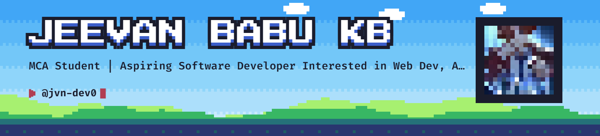

  <!-- Responsive Light/Dark Banner -->
  <picture>
    <source media="(prefers-color-scheme: dark)" srcset="art/header-dark.png">
    
  </picture>

    

  <!-- Title & Typing Animation -->
  <h1>Hey there, I'm Jeevan Babu 👋</h1>

  

    

  <!-- Pink GitHub Badges -->
  

    
    
    
  

<!-- About Me Section -->
<h2 align="center">🌸 About Me</h2>

<table align="center" width="100%">
  <tr>
    <td width="65%" valign="top">
      

        🎓 <strong>Master of Computer Applications (MCA)</strong> student with a passionate drive for building modern web applications, intelligent ML systems, and elegant digital experiences.
      

      

        💻 Constantly exploring modern frontend design systems, scalable backend architectures, and AI/ML algorithms.
      

      

        🌱 Currently deepening knowledge in <strong>Next.js, TypeScript, Python, and Machine Learning</strong>.
      

      

        ✨ Featured Projects:
        <ul>
          <li><strong>BlinkTalker</strong>: AI-powered eye-blink communication system with gaze tracking & Morse-code translation.</li>
          <li><strong>DriveAware AI</strong>: Fatigue risk prediction engine using driving behavior & trip telemetry.</li>
          <li><strong>Flux Financial System</strong>: Clean financial asset tracker & ledger.</li>
          <li><strong>ChronoBid Vault & AUREVANT</strong>: Editorial luxury auction platforms.</li>
        </ul>
      

      

        📫 Reach me anytime at: <a href="mailto:kbjeevanbabu803@gmail.com">kbjeevanbabu803@gmail.com</a>
      

    </td>
    <td width="35%" align="center" valign="middle">
      
    </td>
  </tr>
</table>

 

<!-- Tech Stack -->

  <h2>🛠️ Tech Stack & Tooling</h2>
  
  

    
  

 

<!-- GitHub Streak & Activity Graph (Pink Theme) -->

  <h2>📊 Activity & Streak</h2>

  

    
    &nbsp;
    
  

   

  <!-- GitHub Activity Graph -->
  

    
  

 

<!-- Contribution Snake Animation -->

  <h2>🐍 Contribution Journey</h2>
  
  <!-- 
    NOTE: To generate the snake dynamically, set up the snake GitHub Action workflow in .github/workflows/snake.yml:
    https://github.com/Platane/snk
  -->
  <picture>
    <source media="(prefers-color-scheme: dark)" srcset="https://raw.githubusercontent.com/jvn-dev0/jvn-dev0/output/github-contribution-grid-snake-dark.svg">
    <source media="(prefers-color-scheme: light)" srcset="https://raw.githubusercontent.com/jvn-dev0/jvn-dev0/output/github-contribution-grid-snake.svg">
    
  </picture>

 

<!-- Connect Section -->

  <h2>🤝 Connect With Me</h2>
  
  

    
    &nbsp;
    
    &nbsp;
    
    &nbsp;
    
  

  

<!-- Pink Capsule Render Waving Footer -->

  

